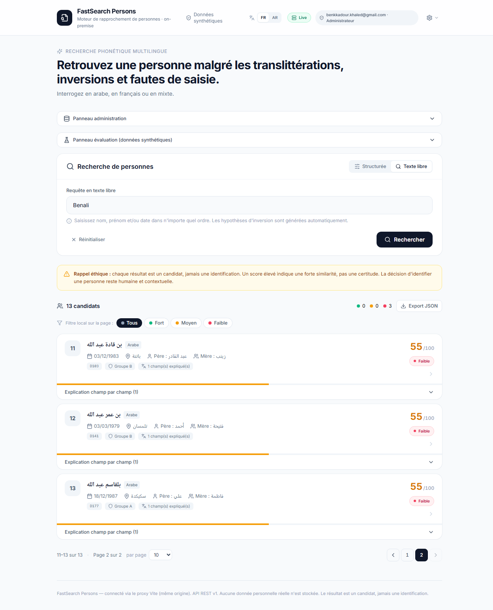
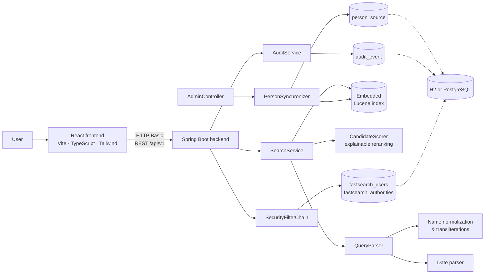

<div align="center">

# FastSearch Persons

**On-premise person matching engine — Arabic / Latin, explainable and access-controlled.**

[](CHANGELOG.md)
[](LICENSE)
[](https://openjdk.org/)
[](https://spring.io/projects/spring-boot)
[](https://lucene.apache.org/)
[](https://react.dev/)
[](https://www.typescriptlang.org/)
[](https://www.postgresql.org/)

[](#quality-and-validation)
[](#quality-and-validation)
[](docs/limitations.md)

[Français](README.md) · **English** · [Documentation](docs/README.md)

</div>

---

> [!IMPORTANT]
> **All data shipped with this project is synthetic.** The 196 people, their
> names, dates, places and identifiers are fictional. No data comes from a real
> person, a civil registry or an external database. The engine returns
> **candidates** with a score; it never performs automatic identification.

<p align="center">
  
  
</p>

## Overview

**FastSearch Persons** is an on-premise search and matching engine for person
records. It combines:

- a **Java 17 / Spring Boot 3.3** backend;
- an embedded **Apache Lucene 9.12** index;
- **H2** by default or **PostgreSQL** with a dedicated profile;
- a versioned REST API `/api/v1`, documented with OpenAPI 3;
- a **React 18 / TypeScript / Vite / Tailwind CSS** web interface;
- stateless **HTTP Basic** authentication with roles and groups;
- a privacy-aware **JPA** audit log;
- a reproducible **synthetic evaluation** module.

It is designed for corpora where the spelling of a name varies: Arabic/Latin
transliterations, first/last name inversion, patronymic particles, typos, OCR
errors, partial dates and multiple numeric formats.

### Design principles

| Principle | Implementation |
|---|---|
| **Source database is the truth** | The Lucene index is a rebuildable artifact synchronized from `person_source`. |
| **Candidate, never identification** | Every result exposes a score, confidence and explanation; the decision remains human. |
| **Explainability** | Field-level details (name, first name, date, place, identifier) are returned by the API and displayed in the UI. |
| **Access control** | Reading groups come from authentication, never from the request body. |
| **Minimization** | The audit log stores a SHA-256 fingerprint, not the raw query. |
| **Sovereignty** | No external API, no SaaS dependency, no mandatory telemetry. |
| **Reproducibility** | The evaluation dataset is deterministic for a given seed. |

### What the project is not

- Not a biometric identification system.
- Not a facial or voice recognition engine.
- Not a database of real people.
- Not production-ready without a security review, TLS, secret management and a
  retention policy.

## Features

### Arabic / Latin multilingual search

- Free-text and structured search.
- Arabic, French and mixed queries.
- Arabic normalization: diacritics, tatweel, alif variants, ya/alif maqsura,
  ta marbuta, Eastern Arabic numerals.
- Latin normalization: accents, ligatures, punctuation, apostrophes, hyphens
  and non-breaking spaces.
- Transliterations and name variants from an embedded dictionary.
- Two phonetic keys (fine and coarse), fuzzy matching on the fine key and
  trigrams for close spellings.
- Patronymic particles (`Ben`, `Bin`, `Ould`, `El`, `Al`, `بن`, `ولد`, `ابن`,
  `ال`…) and Maghrebi prefixes.
- Automatic first/last name inversion.
- Tolerance for typos and OCR errors.
- Search by source identifier, birth date and birth place.

### Explainable matching

- Final score normalized between 0 and 1, displayed out of 100 in the UI.
- Confidence level **`FORT`**, **`MOYEN`** or **`FAIBLE`**.
- Field-by-field explanation with match level and similarity.
- Global `reliable` indicator and warnings for ambiguous queries.
- Conservative rules: a coarse phonetic-only match never exceeds `MOYEN`, a
  date-only query yields `FAIBLE`, a single particle name is capped.

### French / Arabic UI and RTL

- Bilingual **French / Arabic** interface with automatic RTL layout.
- Persisted language choice and `Noto Naskh Arabic` font.
- Result cards with score, confidence, language, group, dates, parents and
  explanations.
- Detailed candidate panel.
- Local confidence filter.
- JSON export of displayed results.
- No demo mode or mocks: every screen uses the real API.

### Server-side pagination

- `page` is 0-based in the API and 1-based in the UI.
- Page sizes: **10, 20, 50, 100**.
- Numbered navigation with ellipsis and previous/next buttons.
- `total` bounded to actually reranked candidates.
- Out-of-range pages clamped to the last available page.
- Global rank preserved across pages.

### Administration, audit and evaluation

- Index statistics, full reindex and incremental synchronization.
- Batched JDBC processing with commit after each batch.
- Paginated audit log with SHA-256 fingerprint, duration and outcome.
- Synthetic evaluation: Recall@10, MRR, nDCG@10, precision@1, false-`FORT`
  rate, per-category metrics and baselines.
- Temporary index for evaluation, never the production index.

## Architecture



See [Architecture](docs/architecture.md) for components, data model and design
trade-offs.

## Repository layout

```text
Fast-Search-Persons/
├── backend/                 Spring Boot API, Lucene, audit, evaluation
│   ├── db/                  SQL export of the 196 synthetic people
│   ├── src/
│   ├── Dockerfile
│   └── pom.xml
├── frontend/                React UI, FR/AR i18n, pagination
│   ├── src/
│   ├── Dockerfile
│   ├── nginx.conf
│   └── package.json
├── docs/                    centralized documentation
│   ├── architecture.md
│   ├── backend.md
│   ├── api.md
│   ├── frontend.md
│   ├── deployment.md
│   ├── limitations.md
│   └── screenshots/
├── scripts/                 documentation checks
├── .github/                 CI, Dependabot, templates
├── docker-compose.yml       PostgreSQL + backend + frontend
├── .env.example             Compose environment variables
├── CHANGELOG.md
├── CONTRIBUTING.md
├── SECURITY.md
├── CODE_OF_CONDUCT.md
├── LICENSE
└── README.md
```

## Quick start

### Requirements

- JDK **17** and Maven **3.9+** for the backend;
- Node.js **22** (or 20.19+) and npm for the frontend;
- Docker and Docker Compose (optional).

### 1. Backend

```bash
cd backend
mvn clean package
java -jar target/fastsearch-persons.jar
```

The backend listens on `http://localhost:8080`. Synthetic demo data is created
on first startup. Health check:

```bash
curl http://localhost:8080/actuator/health
```

To start from an empty database, stop the application and delete
`backend/data`.

### 2. Frontend

```bash
cd frontend
npm ci
npm run dev
```

The interface is available at `http://localhost:5173`. If the port is already
in use:

```bash
npm run dev -- --port 5174
```

Vite proxies `/api` and `/actuator` to `http://localhost:8080`. To target
another backend, set `FASTSEARCH_BACKEND_URL` or copy `frontend/.env.example` to
`frontend/.env`.

### 3. Demo account

```text
Username : benkkadour.khaled@gmail.com
Password : KHALED123
Role     : ADMIN
Groups   : A, B
```

> [!WARNING]
> These credentials are **public and intended for local demonstration only**.
> Replace them before any real deployment. Addresses ending in
> `@fastsearch.test` are fictitious.

## Docker Compose

From the monorepo root:

```bash
docker compose up --build
```

| Service | Local URL |
|---|---|
| Interface | <http://localhost:8081> |
| API | <http://localhost:8080/api/v1> |
| Backend health | <http://localhost:8080/actuator/health> |
| Frontend health | <http://localhost:8081/healthz> |

The stack starts PostgreSQL 16, the backend with the `postgres` profile and the
Nginx frontend. The `pgdata` and `indexdata` volumes persist the database and
the index.

```bash
# Stop without losing volumes
docker compose down

# Stop and remove volumes (data loss)
docker compose down -v
```

Configuration can be customized by copying `.env.example` to `.env`. To disable
demo data:

```bash
FASTSEARCH_DEMO_ENABLED=false docker compose up --build
```

See [Deployment](docs/deployment.md) for TLS, backups and the production
checklist.

## API at a glance

- Swagger UI: <http://localhost:8080/swagger-ui.html>
- OpenAPI document: <http://localhost:8080/v3/api-docs>
- Health: <http://localhost:8080/actuator/health>

Paginated search example:

```bash
curl -u benkkadour.khaled@gmail.com:KHALED123 \
  'http://localhost:8080/api/v1/persons/search?q=Benali&page=0&size=10'
```

`page` is 0-based. `size` is capped at 100. The response contains `hits`,
`total`, `page`, `size`, `reliable`, `message` and `warnings`. An out-of-range
page is clamped to the last available page.

See the full [API reference](docs/api.md).

## Quality and validation

| Check | Result | Command |
|---|---|---|
| Backend tests | **65 / 65** | `cd backend && mvn verify` |
| Frontend tests | **25 / 25** | `cd frontend && npm test` |
| Frontend typecheck | OK | `cd frontend && npm run typecheck` |
| Frontend lint | OK | `cd frontend && npm run lint` |
| Frontend build | OK | `cd frontend && npm run build` |
| FR/AR/RTL browser journeys | **14 / 14** | v0.1.0 validation |
| Browser pagination | **8 / 8** | v0.1.0 validation |
| Markdown links | OK | `node scripts/check-markdown-links.mjs` |

The browser journeys were validated while preparing version 0.1.0 (login,
FR/AR search, RTL, candidate panel, administration, audit, pagination). They
are not yet automated in CI.

GitHub Actions runs the backend, frontend, Markdown link checks and Compose
validation on every push and pull request.

## Security and ethics

- Results are **candidates**, never identifications.
- All shipped data is synthetic and demo accounts must be replaced.
- HTTP Basic must be served behind TLS in production.
- The audit log stores a SHA-256 fingerprint, not the raw query.
- Frontend Basic credentials are kept in `sessionStorage`, for the current tab
  only.
- Vulnerabilities must be reported according to the [security policy](SECURITY.md),
  not in a public issue.
- Before using real data, verify applicable legal obligations (legal basis,
  minimization, retention, data subject rights).

See [Known limitations](docs/limitations.md) for what the engine does not
guarantee.

## Documentation

| Document | Content |
|---|---|
| [Documentation](docs/README.md) | Index and reading paths |
| [Architecture](docs/architecture.md) | Components, flows, data model, security |
| [Backend](docs/backend.md) | Stack, configuration, synchronization, audit, evaluation |
| [API reference](docs/api.md) | Endpoints, parameters, responses, pagination, errors |
| [Frontend](docs/frontend.md) | React UI, FR/AR i18n, RTL, pagination, Docker |
| [Frontend — English](docs/frontend-en.md) | English frontend guide |
| [Backend — English](docs/backend-en.md) | English backend overview |
| [Deployment](docs/deployment.md) | Docker Compose, PostgreSQL, TLS, backups |
| [Limitations](docs/limitations.md) | What the engine does not guarantee |
| [Security](SECURITY.md) | Reporting and security baseline |
| [Contributing](CONTRIBUTING.md) | Development, conventions and PR checklist |
| [Changelog](CHANGELOG.md) | Release history |

## Contributing

Contributions are welcome. Before opening a pull request:

1. read the [contributing guide](CONTRIBUTING.md);
2. run backend and frontend tests;
3. check both languages (FR and AR) and RTL layout;
4. never add real personal data, secrets or mocks;
5. update the documentation and the [changelog](CHANGELOG.md).

The project follows the [Code of Conduct](CODE_OF_CONDUCT.md).

## License

Released under the **MIT** license. See [LICENSE](LICENSE).

Copyright (c) 2026 FastSearch Persons contributors.

> Synthetic data and documentation are provided as examples. Before any
> deployment involving real data, verify applicable legal obligations.

---

<div align="center">

**FastSearch Persons** — candidate search, not identification.

100% synthetic data · MIT license · REST API v1 · Java 17 · Spring Boot · Lucene · React

</div>
