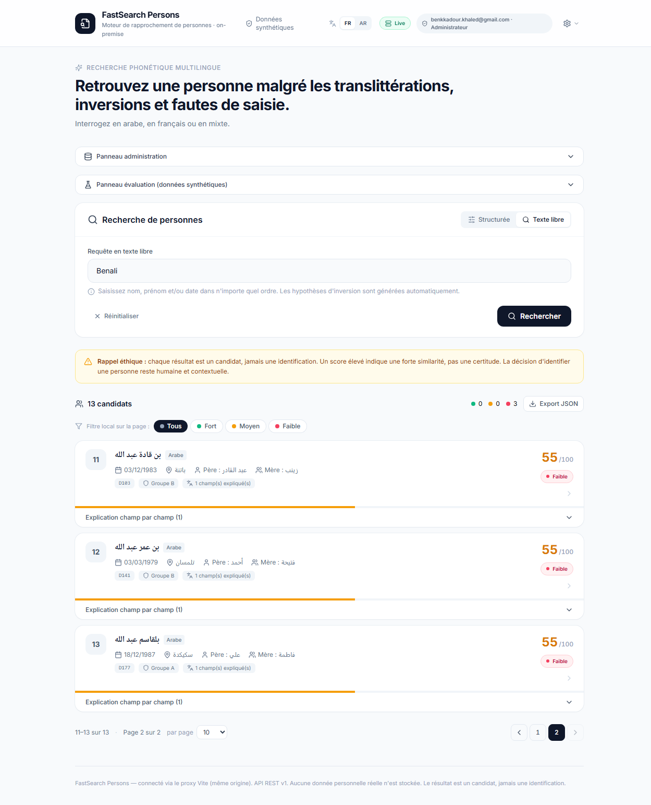
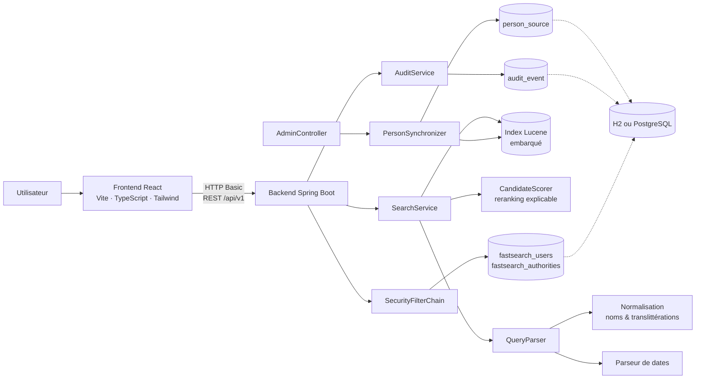

<div align="center">

# FastSearch Persons

**Moteur on-premise de rapprochement de personnes — arabe / latin, explicable et cloisonné.**

[](CHANGELOG.md)
[](LICENSE)
[](https://openjdk.org/)
[](https://spring.io/projects/spring-boot)
[](https://lucene.apache.org/)
[](https://react.dev/)
[](https://www.typescriptlang.org/)
[](https://www.postgresql.org/)

[](#qualité-et-validation)
[](#qualité-et-validation)
[](docs/limitations.md)

**Français** · [English](README.en.md) · [Documentation](docs/README.md)

</div>

---

> [!IMPORTANT]
> **Toutes les données livrées avec ce projet sont synthétiques.** Les 196
> personnes, leurs noms, dates, lieux et identifiants sont inventés. Aucune
> donnée ne provient d'une personne réelle, d'un fichier d'état civil ou d'une
> base externe. Le moteur produit des **candidats** avec un score ; il ne
> réalise jamais une identification automatique.

<p align="center">
  
  
</p>

## Sommaire

- [Vue d'ensemble](#vue-densemble)
- [Fonctionnalités](#fonctionnalités)
- [Architecture](#architecture)
- [Structure du monorepo](#structure-du-monorepo)
- [Démarrage rapide](#démarrage-rapide)
- [Docker Compose](#docker-compose)
- [API en un coup d'œil](#api-en-un-coup-dœil)
- [Qualité et validation](#qualité-et-validation)
- [Sécurité et éthique](#sécurité-et-éthique)
- [Documentation](#documentation)
- [Contribuer](#contribuer)
- [Licence](#licence)

## Vue d'ensemble

**FastSearch Persons** est un moteur de recherche et de rapprochement de
personnes conçu pour fonctionner **entièrement sur site**, sans dépendance à un
service cloud. Il combine :

- un backend **Java 17 / Spring Boot 3.3** ;
- un index de recherche embarqué **Apache Lucene 9.12** ;
- une base relationnelle **H2** par défaut ou **PostgreSQL** en profil dédié ;
- une API REST versionnée `/api/v1`, documentée avec OpenAPI 3 ;
- une interface web **React 18 / TypeScript / Vite / Tailwind CSS** ;
- une authentification **HTTP Basic** sans session, avec rôles et groupes ;
- un journal d'audit **JPA** respectueux des données personnelles ;
- un module d'**évaluation synthétique** reproductible.

Le projet est pensé pour les cas où les graphies d'un même nom varient :
translittérations arabe/latin, inversion nom/prénom, particules de filiation,
fautes de frappe, erreurs OCR, dates incomplètes ou formats numériques
multiples.

### Principes de conception

| Principe | Mise en œuvre |
|---|---|
| **La base source est la vérité** | L'index Lucene est un artefact reconstructible, synchronisé depuis `person_source`. |
| **Candidat, jamais identification** | Chaque résultat expose un score, une confiance et une explication ; la décision reste humaine. |
| **Explicabilité** | Le détail par champ (nom, prénom, date, lieu, identifiant) est renvoyé par l'API et affiché dans l'interface. |
| **Cloisonnement** | Les groupes de lecture viennent de l'authentification, jamais du corps de la requête. |
| **Minimisation** | L'audit ne stocke pas la requête brute, seulement une empreinte SHA-256. |
| **Souveraineté** | Aucune API externe, aucun service SaaS, aucune télémétrie obligatoire. |
| **Reproductibilité** | Le jeu d'évaluation est déterministe pour une graine donnée. |

### Ce que le projet n'est pas

- Ce n'est pas un système d'identification biométrique.
- Ce n'est pas un moteur de reconnaissance faciale ou vocale.
- Ce n'est pas une base de personnes réelles.
- Ce n'est pas un composant « prêt pour la production » sans revue de sécurité,
  TLS, gestion de secrets et politique de conservation.

## Fonctionnalités

### Recherche multilingue arabe / latin

- Recherche en **texte libre** ou en **mode structuré**.
- Requêtes en arabe, en français ou **mixtes**.
- Normalisation arabe : diacritiques, tatweel, variantes de alif, ya/alif
  maqsura, ta marbuta, chiffres arabes indiens.
- Normalisation latine : accents, ligatures, ponctuation, apostrophes, tirets et
  espaces insécables.
- Translittérations et variantes de prénoms/noms via dictionnaire embarqué.
- Deux clés phonétiques (fine et grossière), fuzzy sur la clé fine et trigrammes
  pour les graphies proches.
- Gestion des particules (`Ben`, `Bin`, `Ould`, `El`, `Al`, `بن`, `ولد`, `ابن`,
  `ال`…) et des préfixes de patronymes maghrébins.
- Inversion automatique nom/prénom.
- Tolérance aux fautes de frappe et aux erreurs OCR.
- Recherche par identifiant source, date de naissance et lieu de naissance.

### Rapprochement explicable

- Score final normalisé entre 0 et 1, affiché sur 100 dans l'interface.
- Niveau de confiance **`FORT`**, **`MOYEN`** ou **`FAIBLE`**.
- Explication par champ avec niveau de correspondance et similarité.
- Indicateur global `reliable` et avertissements sur les requêtes ambiguës.
- Règles conservatrices : une clé phonétique grossière ne dépasse jamais
  `MOYEN`, une date seule produit `FAIBLE`, un nom réduit à une particule est
  plafonné.

### Interface FR / AR et RTL

- Interface bilingue **français / arabe**, avec bascule RTL automatique.
- Persistance de la langue choisie et police `Noto Naskh Arabic`.
- Cartes de résultats avec score, confiance, langue, groupe, dates, parents et
  explications.
- Fiche détaillée d'un candidat.
- Filtre local par niveau de confiance.
- Export JSON des résultats affichés.
- Aucun mode démo ou mock : toutes les données viennent de l'API réelle.

### Pagination serveur

- `page` indexé à partir de 0 côté API, affiché à partir de 1 dans l'interface.
- Tailles de page : **10, 20, 50, 100**.
- Navigation numérotée avec ellipse et boutons précédent/suivant.
- `total` borné aux candidats réellement rerankés.
- Page hors limites ramenée à la dernière page disponible.
- Rang global conservé entre les pages.

### Administration, audit et évaluation

- Statistiques de l'index, réindexation complète et synchronisation
  incrémentale.
- Traitement JDBC par lots avec commit après chaque lot.
- Journal d'audit paginé avec empreinte SHA-256, durée et état.
- Évaluation synthétique : Recall@10, MRR, nDCG@10, précision@1, taux de faux
  `FORT`, métriques par catégorie et baselines.
- Index temporaire pour l'évaluation, jamais l'index de production.

## Architecture



Le détail des composants, du modèle de données et des choix techniques est dans
[Architecture](docs/architecture.md).

## Structure du monorepo

```text
Fast-Search-Persons/
├── backend/                 API Spring Boot, Lucene, audit, évaluation
│   ├── db/                  export SQL des 196 personnes synthétiques
│   ├── src/
│   ├── Dockerfile
│   └── pom.xml
├── frontend/                interface React, i18n FR/AR, pagination
│   ├── src/
│   ├── Dockerfile
│   ├── nginx.conf
│   └── package.json
├── docs/                    documentation centralisée
│   ├── architecture.md
│   ├── backend.md
│   ├── api.md
│   ├── frontend.md
│   ├── deployment.md
│   ├── limitations.md
│   └── screenshots/
├── scripts/                 vérifications de documentation
├── .github/                 CI, Dependabot, templates
├── docker-compose.yml       PostgreSQL + backend + frontend
├── .env.example             variables d'environnement Compose
├── CHANGELOG.md
├── CONTRIBUTING.md
├── SECURITY.md
├── CODE_OF_CONDUCT.md
├── LICENSE
└── README.md
```

## Démarrage rapide

### Prérequis

- JDK **17** et Maven **3.9+** pour le backend ;
- Node.js **22** (ou 20.19+) et npm pour le frontend ;
- Docker et Docker Compose (optionnel).

### 1. Backend

```bash
cd backend
mvn clean package
java -jar target/fastsearch-persons.jar
```

Le backend écoute sur `http://localhost:8080`. Les données synthétiques de
démonstration sont créées au premier démarrage. Vérification :

```bash
curl http://localhost:8080/actuator/health
```

Pour repartir d'une base vide, arrêter l'application et supprimer
`backend/data`.

### 2. Frontend

```bash
cd frontend
npm ci
npm run dev
```

L'interface est disponible sur `http://localhost:5173`. Si ce port est déjà
utilisé :

```bash
npm run dev -- --port 5174
```

Le proxy Vite redirige `/api` et `/actuator` vers `http://localhost:8080`.
Pour cibler un autre backend, définir `FASTSEARCH_BACKEND_URL` ou copier
`frontend/.env.example` vers `frontend/.env`.

### 3. Compte de démonstration

```text
Identifiant : benkkadour.khaled@gmail.com
Mot de passe : KHALED123
Rôle         : ADMIN
Groupes      : A, B
```

> [!WARNING]
> Ces identifiants sont **publics et réservés à la démonstration locale**. Ils
> doivent être remplacés avant tout déploiement réel. Les adresses
> `@fastsearch.test` sont fictives.

## Docker Compose

Depuis la racine du monorepo :

```bash
docker compose up --build
```

| Service | URL locale |
|---|---|
| Interface | <http://localhost:8081> |
| API | <http://localhost:8080/api/v1> |
| Santé backend | <http://localhost:8080/actuator/health> |
| Santé frontend | <http://localhost:8081/healthz> |

La composition démarre PostgreSQL 16, le backend avec le profil `postgres` et le
frontend Nginx. Les volumes `pgdata` et `indexdata` conservent la base et
l'index.

```bash
# Arrêt sans perte de volumes
docker compose down

# Arrêt avec suppression des volumes (perte des données)
docker compose down -v
```

La configuration peut être personnalisée en copiant `.env.example` vers `.env`.
Pour désactiver les données de démonstration :

```bash
FASTSEARCH_DEMO_ENABLED=false docker compose up --build
```

Voir [Déploiement](docs/deployment.md) pour TLS, sauvegardes et checklist de
production.

## API en un coup d'œil

- Swagger UI : <http://localhost:8080/swagger-ui.html>
- Document OpenAPI : <http://localhost:8080/v3/api-docs>
- Santé : <http://localhost:8080/actuator/health>

Exemple de recherche paginée :

```bash
curl -u benkkadour.khaled@gmail.com:KHALED123 \
  'http://localhost:8080/api/v1/persons/search?q=Benali&page=0&size=10'
```

`page` est indexé à partir de 0. `size` est borné à 100. La réponse contient
`hits`, `total`, `page`, `size`, `reliable`, `message` et `warnings`. Une page
hors limites est ramenée à la dernière page disponible.

La référence complète est dans [Référence API](docs/api.md).

## Qualité et validation

| Vérification | Résultat | Commande |
|---|---|---|
| Tests backend | **65 / 65** | `cd backend && mvn verify` |
| Tests frontend | **25 / 25** | `cd frontend && npm test` |
| Typecheck frontend | OK | `cd frontend && npm run typecheck` |
| Lint frontend | OK | `cd frontend && npm run lint` |
| Build frontend | OK | `cd frontend && npm run build` |
| Parcours navigateur FR/AR/RTL | **14 / 14** | validation de la v0.1.0 |
| Pagination navigateur | **8 / 8** | validation de la v0.1.0 |
| Liens Markdown | OK | `node scripts/check-markdown-links.mjs` |

Les parcours navigateur ont été validés lors de la préparation de la version
0.1.0 (connexion, recherche FR/AR, RTL, fiche candidat, administration, audit,
pagination). Ils ne sont pas encore automatisés dans la CI.

La CI GitHub Actions exécute le backend, le frontend, la vérification des liens
Markdown et la validation du fichier Compose à chaque push et pull request.

## Sécurité et éthique

- Les résultats sont des **candidats**, jamais des identifications.
- Les données livrées sont synthétiques et les comptes de démonstration doivent
  être remplacés.
- HTTP Basic doit être servi derrière TLS en production.
- Le journal d'audit conserve une empreinte SHA-256, pas la requête brute.
- Les identifiants Basic du frontend sont conservés dans `sessionStorage`, pour
  l'onglet courant uniquement.
- Les vulnérabilités doivent être signalées selon la
  [politique de sécurité](SECURITY.md), pas dans une issue publique.
- Avant toute utilisation sur des données réelles, vérifier les obligations
  légales applicables (base légale, minimisation, conservation, droits des
  personnes).

Voir [Limites connues](docs/limitations.md) pour ce que le moteur ne garantit
pas.

## Documentation

| Document | Contenu |
|---|---|
| [Documentation](docs/README.md) | Index et parcours de lecture |
| [Architecture](docs/architecture.md) | Composants, flux, modèle de données, sécurité |
| [Backend](docs/backend.md) | Stack, configuration, synchronisation, audit, évaluation |
| [Référence API](docs/api.md) | Endpoints, paramètres, réponses, pagination, erreurs |
| [Frontend](docs/frontend.md) | Interface React, i18n FR/AR, RTL, pagination, Docker |
| [Frontend — English](docs/frontend-en.md) | English version of the frontend guide |
| [Backend — English](docs/backend-en.md) | English overview of the backend |
| [Déploiement](docs/deployment.md) | Docker Compose, PostgreSQL, TLS, sauvegardes |
| [Limites](docs/limitations.md) | Ce que le moteur ne garantit pas |
| [Sécurité](SECURITY.md) | Signalement et socle de sécurité |
| [Contribution](CONTRIBUTING.md) | Développement, conventions et checklist de PR |
| [Journal des modifications](CHANGELOG.md) | Historique des versions |

## Contribuer

Les contributions sont bienvenues. Avant d'ouvrir une pull request :

1. lire le [guide de contribution](CONTRIBUTING.md) ;
2. exécuter les tests backend et frontend ;
3. vérifier les deux langues (FR et AR) et le sens RTL ;
4. ne jamais ajouter de données personnelles réelles, de secret ou de mock ;
5. mettre à jour la documentation et le [journal des modifications](CHANGELOG.md).

Le projet suit le [Code de conduite](CODE_OF_CONDUCT.md).

## Licence

Projet publié sous licence **MIT**. Voir [LICENSE](LICENSE).

Copyright (c) 2026 FastSearch Persons contributors.

> Les données synthétiques et la documentation sont fournies à titre d'exemple.
> Avant tout déploiement traitant des données réelles, vérifier les obligations
> légales applicables.

---

<div align="center">

**FastSearch Persons** — recherche de candidats, pas identification.

Données 100 % synthétiques · Licence MIT · API REST v1 · Java 17 · Spring Boot · Lucene · React

</div>
