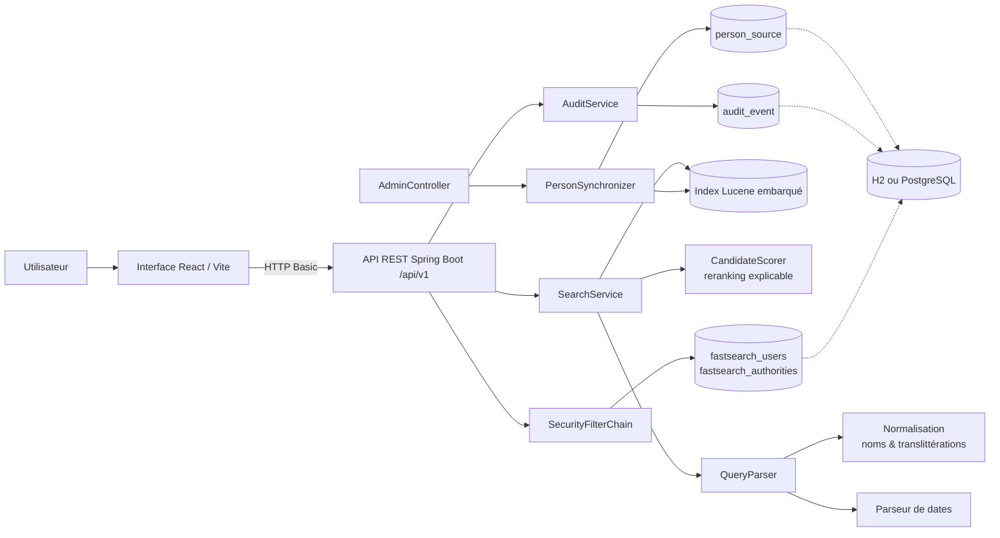
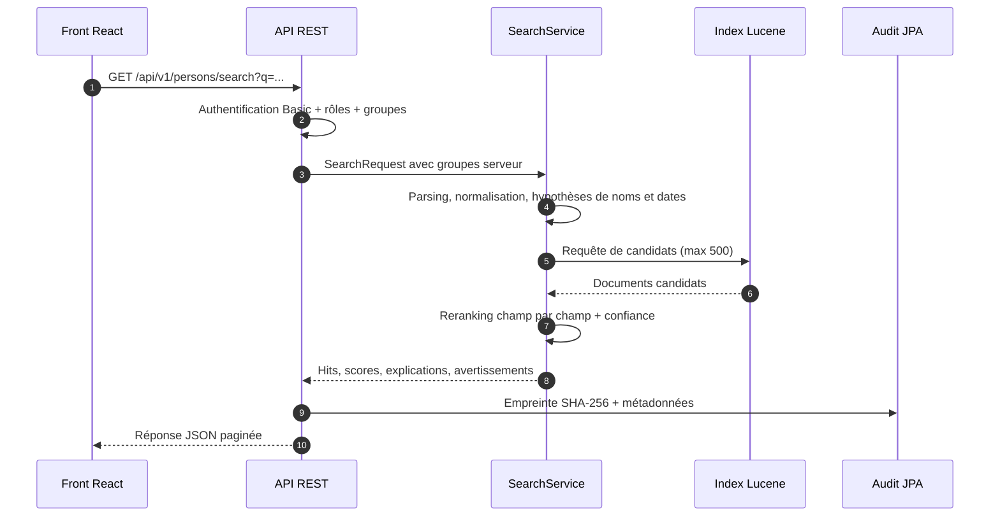
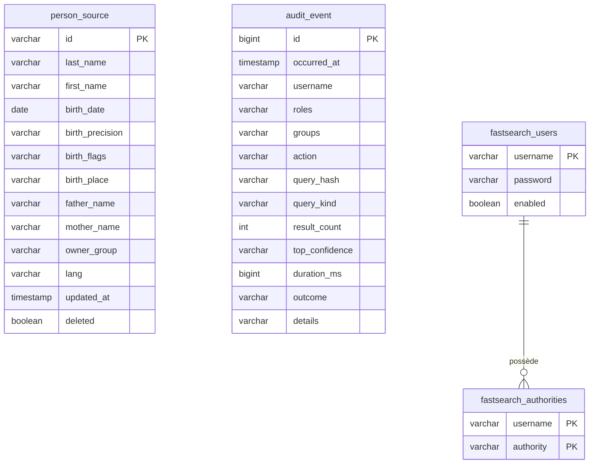

<div align="center">

# FastSearch Persons

**Moteur on-premise de rapprochement de personnes — arabe / latin, explicable et cloisonné.**

**Version 0.1.0 — première version publique.**

[](CHANGELOG.md)
[](https://openjdk.org/)
[](https://spring.io/projects/spring-boot)
[](https://lucene.apache.org/)
[](https://react.dev/)
[](https://www.typescriptlang.org/)
[](https://www.postgresql.org/)
[](LICENSE)
[](#tests-et-qualité)
[](#limites-et-précautions)

[Vue d'ensemble](#vue-densemble) · [Fonctionnalités](#fonctionnalités) · [Architecture](#architecture) · [Démarrage](#démarrage-rapide) · [API](#api-rest) · [Données](#données-synthétiques) · [Sécurité](#sécurité)

**Français** · [English](README_GITHUB_EN.md)

</div>

---

> [!IMPORTANT]
> **Toutes les données de ce projet sont synthétiques.** Les 196 personnes,
> leurs noms, dates, lieux et identifiants sont inventés. Aucune donnée ne
> provient d'une personne réelle, d'un fichier d'état civil ou d'une base
> externe. Le moteur produit des **candidats** avec un score ; il ne réalise
> jamais une identification automatique.

---

## Sommaire

- [Vue d'ensemble](#vue-densemble)
- [Fonctionnalités](#fonctionnalités)
- [Architecture](#architecture)
- [Stack technique](#stack-technique)
- [Démarrage rapide](#démarrage-rapide)
- [Comptes de démonstration](#comptes-de-démonstration)
- [API REST](#api-rest)
- [Sécurité](#sécurité)
- [Données synthétiques](#données-synthétiques)
- [Synchronisation JDBC et indexation](#synchronisation-jdbc-et-indexation)
- [Interface web](#interface-web)
- [Évaluation synthétique](#évaluation-synthétique)
- [Configuration](#configuration)
- [Tests et qualité](#tests-et-qualité)
- [Docker](#docker)
- [Structure du dépôt](#structure-du-dépôt)
- [Limites et précautions](#limites-et-précautions)
- [Licence](#licence)

---

## Vue d'ensemble

**FastSearch Persons** est un moteur de recherche et de rapprochement de
personnes conçu pour fonctionner **entièrement sur site**, sans dépendance à
un service cloud. Il combine :

- un backend **Java 17 / Spring Boot 3.3** ;
- un index de recherche embarqué **Apache Lucene 9.12** ;
- une base relationnelle **H2** par défaut ou **PostgreSQL** en profil dédié ;
- une API REST versionnée `/api/v1` ;
- une interface web **React 18 / TypeScript / Vite / Tailwind CSS** ;
- une authentification **HTTP Basic** sans session, avec rôles et groupes ;
- un journal d'audit **JPA** respectueux des données personnelles ;
- un module d'**évaluation synthétique** reproductible.

Le projet est pensé pour les cas où les graphies d'un même nom varient :
translittérations arabe/latin, inversion nom/prénom, particules de filiation,
fautes de frappe, erreurs OCR, dates incomplètes ou formats numériques
multiples.

### Principes de conception

| Principe | Mise en œuvre |
|---|---|
| **La base source est la vérité** | L'index Lucene est un artefact reconstructible, synchronisé depuis `person_source`. |
| **Candidat, jamais identification** | Chaque résultat expose un score, une confiance et une explication ; la décision reste humaine. |
| **Explicabilité** | Le détail par champ (nom, prénom, date, lieu, identifiant) est renvoyé par l'API et affiché dans l'interface. |
| **Cloisonnement** | Les groupes de lecture viennent de l'authentification, jamais du corps de la requête. |
| **Minimisation** | L'audit ne stocke pas la requête brute, seulement une empreinte SHA-256. |
| **Souveraineté** | Aucune API externe, aucun service SaaS, aucune télémétrie obligatoire. |
| **Reproductibilité** | Le jeu d'évaluation est déterministe pour une graine donnée. |

### Ce que le projet n'est pas

- Ce n'est pas un système d'identification biométrique.
- Ce n'est pas un moteur de reconnaissance faciale ou vocale.
- Ce n'est pas une base de personnes réelles.
- Ce n'est pas un composant « prêt pour la production » sans revue de
  sécurité, TLS, gestion de secrets et politique de conservation.

---

## Fonctionnalités

### 1. Recherche multilingue arabe / latin

- Recherche en **texte libre** ou en **mode structuré**.
- Requêtes en arabe, en français ou **mixtes**.
- Normalisation arabe : diacritiques, tatweel, variantes de alif, ya/alif
  maqsura, ta marbuta, chiffres arabes indiens.
- Normalisation latine : accents, ligatures, ponctuation, apostrophes,
  tirets et espaces insécables.
- Translittérations et variantes de prénoms/noms via dictionnaire embarqué.
- Deux clés phonétiques (fine et grossière), fuzzy sur la clé fine et
  trigrammes pour les graphies proches.
- Gestion des particules (`Ben`, `Bin`, `Ould`, `El`, `Al`, `بن`, `ولد`,
  `ابن`, `ال`…) et des préfixes de patronymes maghrébins.
- Inversion automatique nom/prénom.
- Tolérance aux fautes de frappe et aux erreurs OCR.
- Recherche par identifiant source.
- Recherche par date de naissance et lieu de naissance ; les noms des parents
  sont indexés et affichés dans les résultats.

### 2. Rapprochement explicable

Chaque candidat renvoie :

- un **score final** normalisé entre 0 et 1, affiché sur 100 dans l'interface ;
- un niveau de confiance **`FORT`**, **`MOYEN`** ou **`FAIBLE`** ;
- une **explication par champ** avec niveau de correspondance et similarité ;
- un indicateur global `reliable` ;
- des avertissements lorsque la requête est ambiguë ou limitée.

Le score final n'est pas le score Lucene brut : il est recalculé champ par
champ par le reranker. Les règles de confiance sont volontairement
conservatrices :

- identifiant exact → `FORT` ;
- nom fort, date compatible et absence d'indice contradictoire → `FORT` ;
- clé phonétique **grossière** ou correspondance arabe/latin non confirmée par
  le dictionnaire → jamais `FORT` ;
- nom de famille réduit à une particule avec une requête à un seul jeton →
  plafonné à `MOYEN` ;
- date seule, sans nom exploitable → `FAIBLE` ;
- `reliable = true` seulement si le premier candidat n'est pas `FAIBLE` et
  que son score atteint `0.60`.

### 3. Dates intelligentes

Formats pris en charge :

- `jj/mm/aaaa`, `jj-mm-aa`, séparateurs mélangés ;
- ISO `aaaa-mm-jj` ;
- compact `jjmmaaaa`, `jjmmaa`, `jmmaaaa`, `jmmaa` avec gestion des zéros
  initiaux perdus ;
- mois en lettres françaises ou arabes ;
- année seule ;
- mois/année.

Le parseur :

- vérifie strictement le calendrier grégorien ;
- rejette les dates futures ou hors plage ;
- produit plusieurs hypothèses pondérées en cas d'ambiguïté ;
- gère le pivot de siècle via une horloge injectée ;
- signale les ambiguïtés numériques entre date et identifiant.

### 4. Cloisonnement par groupes

- Rôles : `ADMIN`, `ANALYST`, `READER`.
- Groupes : autorités `GROUP_xxx` issues de l'authentification.
- Filtre Lucene appliqué côté serveur.
- Seconde vérification défensive dans le service de recherche.
- Le client ne peut pas choisir ses groupes dans le JSON ou les paramètres.

### 5. Administration de l'index

- Statistiques de l'index (documents, maximum, supprimés, état, chemin).
- Réindexation complète.
- Synchronisation incrémentale par date `updated_at`.
- Suppression logique via la colonne `deleted`.
- Traitement par lots avec commit après chaque lot.
- Aucun endpoint de commit manuel exposé.

### 6. Journal d'audit

- Événements `SEARCH`, `REINDEX`, `SYNC`, `EVAL`.
- Utilisateur, rôles, groupes, action, résultat, confiance, durée, état.
- Empreinte SHA-256 de la requête, jamais son texte brut.
- Pagination et consultation réservées à `ADMIN`.
- L'échec d'écriture d'audit ne rend pas la recherche indisponible.

### 7. Interface web

- Écran de connexion.
- Session conservée dans `sessionStorage`, sans cookie serveur.
- URL de backend configurable ; vide = même origine via proxy Vite.
- Recherche structurée ou texte libre.
- Cartes de résultats avec score, confiance, langue, groupe, date, lieu,
  parents et identifiant.
- Affichage RTL automatique pour les noms arabes.
- Panneau de détail latéral avec explication complète.
- Filtre local par niveau de confiance sur la page courante.
- Pagination et choix de la taille de page.
- Export JSON des résultats affichés.
- Panneau d'administration (index + audit) réservé à `ADMIN`.
- Panneau d'évaluation réservé à `ADMIN` et `ANALYST`.
- Aucun mode démo/mock : toutes les données viennent de l'API réelle.

### 8. Évaluation synthétique

- Jeu de cas généré de façon déterministe à partir d'une graine.
- Index temporaire, jamais l'index de production.
- Métriques : Recall@10, MRR, nDCG@10, précision@1, taux de faux `FORT`.
- Métriques par catégorie : exact, inversion, arabe, translittération, faute,
  date, homonymes.
- Baseline SQL `LIKE` simulée.
- Baseline OpenSearch optionnelle, signalée indisponible si non configurée.
- Suggestions de lignes de dictionnaire, jamais appliquées automatiquement.

---

## Architecture

### Vue logique



### Déroulement d'une recherche



### Modèle de données principal



---

## Stack technique

| Couche | Technologie | Version / rôle |
|---|---|---|
| Langage backend | Java | 17 |
| Framework | Spring Boot | 3.3.13 |
| Web | Spring MVC, Bean Validation | API REST, DTO, erreurs structurées |
| Sécurité | Spring Security | HTTP Basic, rôles, groupes, BCrypt |
| Persistance | Spring Data JPA + JDBC | audit JPA, source JDBC par lots |
| Recherche | Apache Lucene | 9.12.2, index embarqué |
| Bases | H2 / PostgreSQL | H2 par défaut, PostgreSQL en profil |
| Tests | JUnit 5, Spring Boot Test, ArchUnit | 62 tests |
| Build | Maven | `pom.xml` unique |
| Frontend | React 18, TypeScript 5.5 | interface SPA |
| Build front | Vite 7 | dev server, proxy, build |
| Styles | Tailwind CSS 3 | UI responsive |
| Icônes | Lucide React | iconographie |
| Conteneurs | Docker, Docker Compose | PostgreSQL 16 + application |

### Contraintes d'architecture

Les packages suivants sont volontairement **indépendants de Spring et JPA** :

```text
com.fastsearch.persons.analysis
com.fastsearch.persons.names
com.fastsearch.persons.dates
com.fastsearch.persons.search
```

Un test **ArchUnit** vérifie cette règle. L'objectif est de garder le cœur du
moteur testable et réutilisable en dehors du contexte Spring.

---

## Démarrage rapide

### Prérequis

- JDK 17 ;
- Maven 3.9+ ;
- Node.js 20+ et npm pour l'interface web ;
- PostgreSQL 16+ (optionnel, pour le profil `postgres`) ;
- Docker et Docker Compose (optionnel).

### Backend avec H2 (défaut)

```bash
mvn clean test
mvn package
java -jar target/fastsearch-persons.jar
```

Par défaut :

- base H2 fichier dans `./data/fastsearch` ;
- index Lucene dans `./data/index` ;
- **196 personnes synthétiques** insérées au démarrage ;
- API sur `http://localhost:8080`.

Vérification :

```bash
curl http://localhost:8080/actuator/health
```

Pour repartir d'une base vide, arrêter l'application puis supprimer `./data`.

### Backend avec PostgreSQL

Créer une base et un rôle (adapter selon votre installation) :

```bash
psql -U postgres -c "CREATE USER fastsearch WITH PASSWORD 'fastsearch';"
psql -U postgres -c "CREATE DATABASE fastsearch OWNER fastsearch;"
```

Lancer avec le profil `postgres` :

```bash
export SPRING_PROFILES_ACTIVE=postgres
export FASTSEARCH_DB_URL=jdbc:postgresql://localhost:5432/fastsearch
export FASTSEARCH_DB_USER=fastsearch
export FASTSEARCH_DB_PASSWORD=fastsearch
java -jar target/fastsearch-persons.jar
```

Sous PowerShell :

```powershell
$env:SPRING_PROFILES_ACTIVE = 'postgres'
$env:FASTSEARCH_DB_URL = 'jdbc:postgresql://localhost:5432/fastsearch'
$env:FASTSEARCH_DB_USER = 'fastsearch'
$env:FASTSEARCH_DB_PASSWORD = 'fastsearch'
java -jar target\fastsearch-persons.jar
```

Le profil `postgres` :

- active les données de démonstration par défaut ;
- crée et alimente les tables d'identités `fastsearch_users` et
  `fastsearch_authorities` ;
- utilise le stock d'identités JDBC (`fastsearch.security.store: jdbc`) ;
- conserve les comptes existants : un redémarrage n'écrase ni mot de passe ni
  autorité déjà présente.

### Importer l'export SQL

Le fichier [`db/person_source_data.sql`](db/person_source_data.sql) contient
les **196 INSERT** de `public.person_source`, encadrés par une transaction.

```bash
psql -U fastsearch -d fastsearch -f db/person_source_data.sql
```

> [!NOTE]
> Importer ce fichier sur une base **vide** ou décommenter le `TRUNCATE`
> présent dans l'en-tête si la table contient déjà les données. Si
> l'application a déjà démarré avec les données de démonstration, les 196
> lignes sont déjà présentes : l'initialiseur est idempotent par `id`.

Vérification :

```sql
SELECT COUNT(*) FROM public.person_source;
-- 196

SELECT lang, COUNT(*)
FROM public.person_source
GROUP BY lang
ORDER BY lang;
-- ar : 103
-- fr : 93
```

### Interface web

Dans le projet frontend associé :

```bash
npm install
npm run dev
```

Le proxy Vite relaie `/api` et `/actuator` vers `http://localhost:8080` par
défaut. Pour cibler un autre backend :

```bash
FASTSEARCH_BACKEND_URL=http://localhost:18080 npm run dev
```

Sous PowerShell :

```powershell
$env:FASTSEARCH_BACKEND_URL = 'http://localhost:18080'
npm run dev
```

Ouvrir ensuite l'URL affichée par Vite (généralement
`http://localhost:5173`).

### Docker Compose

```bash
docker compose up --build
```

La composition démarre :

- **PostgreSQL 16** avec les volumes `pgdata` ;
- l'application Spring Boot avec le profil `postgres` ;
- l'index Lucene dans le volume `indexdata` ;
- les données de démonstration activées par défaut.

```bash
# Arrêt sans perte de volumes
docker compose down

# Arrêt avec suppression des volumes (perte des données)
docker compose down -v
```

Pour désactiver les données synthétiques :

```bash
FASTSEARCH_DEMO_ENABLED=false docker compose up --build
```

---

## Comptes de démonstration

> [!WARNING]
> Ces comptes sont **publics et réservés à la démonstration locale**. Les
> remplacer avant tout déploiement. Les adresses `@fastsearch.test` sont
> fictives.

| Utilisateur | Mot de passe | Rôle | Groupes |
|---|---|---|---|
| `benkkadour.khaled@gmail.com` | `KHALED123` | `ADMIN` | A, B |
| `amina.benali@fastsearch.test` | `Amina-Analyste-2026` | `ANALYST` | A |
| `yassine.merabet@fastsearch.test` | `Yassine-Analyste-2026` | `ANALYST` | B |
| `sara.haddad@fastsearch.test` | `Sara-Lecteur-2026` | `READER` | A |
| `karim.bouzid@fastsearch.test` | `Karim-Lecteur-2026` | `READER` | B |

En profil PostgreSQL, ces comptes sont persistés dans les tables
`fastsearch_users` et `fastsearch_authorities`, avec des mots de passe
**BCrypt**. En mémoire (H2 par défaut), ils sont chargés depuis la
configuration `fastsearch.security.users`.

---

## API REST

Base : `http://localhost:8080/api/v1`

| Méthode | Chemin | Accès | Description |
|---|---|---|---|
| `GET` | `/actuator/health`, `/actuator/info` | Public | Santé et information |
| `GET` | `/actuator/**` | `ADMIN` | Métriques et autres endpoints |
| `GET` | `/api/v1/auth/me` | Authentifié | Identité, rôles et groupes |
| `GET` | `/api/v1/persons/search` | `ADMIN`, `ANALYST`, `READER` | Recherche par paramètres |
| `POST` | `/api/v1/persons/search` | `ADMIN`, `ANALYST`, `READER` | Recherche structurée JSON |
| `GET` | `/api/v1/admin/index/stats` | `ADMIN` | Statistiques de l'index |
| `POST` | `/api/v1/admin/index/reindex` | `ADMIN` | Réindexation complète |
| `POST` | `/api/v1/admin/index/sync` | `ADMIN` | Synchronisation incrémentale |
| `GET` | `/api/v1/admin/audit` | `ADMIN` | Journal d'audit paginé |
| `POST` | `/api/v1/eval/run` | `ADMIN`, `ANALYST` | Évaluation synthétique |

### Recherche en texte libre

```bash
curl -u sara.haddad@fastsearch.test:Sara-Lecteur-2026 \
  --get --data-urlencode 'q=Oualid Benali 07/04/1992' \
  http://localhost:8080/api/v1/persons/search
```

Exemple arabe :

```bash
curl -u sara.haddad@fastsearch.test:Sara-Lecteur-2026 \
  --get --data-urlencode 'q=وليد بن علي' \
  http://localhost:8080/api/v1/persons/search
```

### Recherche structurée

```bash
curl -u sara.haddad@fastsearch.test:Sara-Lecteur-2026 \
  -H 'Content-Type: application/json' \
  -d '{
        "lastName": "Benali",
        "firstName": "Walid",
        "birthDate": "07/04/1992",
        "birthPlace": "Alger",
        "page": 0,
        "size": 20,
        "includeExplanation": true
      }' \
  http://localhost:8080/api/v1/persons/search
```

### Paramètres

| Paramètre | Type | Défaut | Rôle |
|---|---|---|---|
| `q` | string | — | Requête libre (nom, date, identifiant) |
| `lastName` | string | — | Nom |
| `firstName` | string | — | Prénom |
| `birthDate` | string | — | Date de naissance |
| `birthPlace` | string | — | Lieu de naissance |
| `page` | int | `0` | Page, base 0 côté API |
| `size` | int | `20` | Taille de page, maximum serveur `100` |
| `explain` / `includeExplanation` | boolean | `true` | Inclure les explications |

### Réponse

```json
{
  "hits": [
    {
      "id": "D001",
      "lastName": "Benali",
      "firstName": "Walid",
      "fullName": "Benali Walid",
      "birthDate": "1992-04-07",
      "birthPrecision": "JOUR",
      "birthPlace": "Alger",
      "fatherName": "",
      "motherName": "",
      "ownerGroup": "A",
      "lang": "fr",
      "score": 1.0,
      "confidence": "FORT",
      "explanations": [
        {
          "field": "nom",
          "level": "EXACT",
          "detail": "comparaison directe : exact",
          "score": 1.0
        }
      ]
    }
  ],
  "total": 1,
  "page": 0,
  "size": 20,
  "reliable": true,
  "message": "Candidats proposés ; aucun résultat ne constitue une identification.",
  "warnings": []
}
```

### Identité

```bash
curl -u sara.haddad@fastsearch.test:Sara-Lecteur-2026 \
  http://localhost:8080/api/v1/auth/me
```

```json
{
  "username": "sara.haddad@fastsearch.test",
  "roles": ["READER"],
  "groups": ["A"]
}
```

### Administration

```bash
# Statistiques
curl -u benkkadour.khaled@gmail.com:KHALED123 \
  http://localhost:8080/api/v1/admin/index/stats

# Réindexation complète
curl -u benkkadour.khaled@gmail.com:KHALED123 -X POST \
  http://localhost:8080/api/v1/admin/index/reindex

# Synchronisation incrémentale
curl -u benkkadour.khaled@gmail.com:KHALED123 -X POST \
  'http://localhost:8080/api/v1/admin/index/sync?full=false&since=2026-01-01T00:00:00Z&batchSize=500'

# Audit
curl -u benkkadour.khaled@gmail.com:KHALED123 \
  'http://localhost:8080/api/v1/admin/audit?page=0&size=50'
```

### Évaluation

```bash
curl -u amina.benali@fastsearch.test:Amina-Analyste-2026 -X POST \
  'http://localhost:8080/api/v1/eval/run?seed=42&count=24'
```

### Codes d'erreur

| Code | Signification |
|---|---|
| `400` | Requête invalide, champ trop long ou JSON mal formé |
| `401` | Authentification absente ou invalide |
| `403` | Rôle insuffisant ou groupe non autorisé |
| `404` | Ressource inconnue |
| `500` | Erreur interne |

---

## Sécurité

### Authentification et autorisation

- **HTTP Basic** sur chaque requête.
- Sessions serveur **désactivées** (`STATELESS`).
- Mots de passe **BCrypt**.
- Rôles `ADMIN`, `ANALYST`, `READER`.
- Autorités de groupe `GROUP_A`, `GROUP_B`, etc.
- Sécurisation des URLs et des méthodes (`@PreAuthorize`).
- CORS explicite pour les origines Vite locales.
- En-tête `WWW-Authenticate` exposé au front.

### Cloisonnement des données

Le client ne fournit jamais ses groupes. Le contrôleur les extrait de
l'objet `Authentication` :

```java
Set<String> groups = currentUser.groups(authentication);
SearchRequest request = body.toSearchRequest(groups);
```

Le filtre est appliqué dans la requête Lucene, puis vérifié une seconde fois
dans `SearchService` avant le reranking.

### Audit et vie privée

Le journal stocke :

- l'utilisateur, ses rôles et ses groupes ;
- l'action et son résultat ;
- le nombre de résultats, la confiance du premier hit et la durée ;
- une **empreinte SHA-256** de la requête.

Il ne stocke **jamais** :

- le texte brut de la requête ;
- les valeurs de nom, prénom, date ou lieu ;
- les documents Lucene.

### Durcissement recommandé avant production

- Placer l'application derrière **HTTPS/TLS**.
- Remplacer les comptes de démonstration.
- Utiliser un gestionnaire de secrets.
- Restreindre les origines CORS.
- Ajouter une limitation de débit et un reverse proxy.
- Remplacer `ddl-auto=update` par des migrations versionnées
  (Flyway/Liquibase).
- Mettre en place une politique de conservation et de purge de l'audit.
- Protéger l'interface contre le XSS, car le header Basic est conservé en
  `sessionStorage`.
- Effectuer une revue de sécurité et des tests de charge sur le corpus réel.

---

## Données synthétiques

### Composition

| Indicateur | Valeur |
|---|---|
| Personnes | **196** |
| Identifiants | `D001` à `D196` |
| Langue arabe (`lang = ar`) | **103** |
| Langue latine (`lang = fr`) | **93** |
| Groupe A | **127** |
| Groupe B | **69** |
| Index Lucene | **196 documents** |
| Export SQL | **196 INSERT** |

Les données couvrent volontairement :

- des noms arabes et latins ;
- des translittérations et variantes ;
- des particules (`Ben`, `Ould`, `El`, `بن`, `ولد`…) ;
- des dates de précision `JOUR`, `MOIS`, `ANNEE` ;
- des lieux en arabe et en français ;
- des homonymes et des personnes du même groupe ;
- un enregistrement protégé (`D005`) pour vérifier le cloisonnement ;
- des personnes réparties entre les groupes A et B.

### Fichier SQL

Le fichier [`db/person_source_data.sql`](db/person_source_data.sql) est un
export `pg_dump --data-only --column-inserts` nettoyé :

- UTF-8 sans BOM ;
- 196 `INSERT` vers `public.person_source` ;
- transaction `BEGIN;` / `COMMIT;` ;
- aucun `\restrict` / `\unrestrict` non portable ;
- aucun `SET transaction_timeout` ;
- en-tête documenté et instructions d'import.

Contenu type :

```sql
INSERT INTO public.person_source (
  id, last_name, first_name, birth_date, birth_precision, birth_flags,
  birth_place, father_name, mother_name, owner_group, lang, updated_at, deleted
) VALUES (
  'D097', 'عثماني', 'عبد الحق', '1988-02-12', 'JOUR', '',
  'الجزائر', 'محمد', 'فاطمة', 'A', 'ar', '2026-11-12 09:43:33.426976', false
);
```

### Schéma de `person_source`

| Colonne | Type | Rôle |
|---|---|---|
| `id` | `varchar(32)` PK | Identifiant source |
| `last_name` | `varchar(100)` | Nom |
| `first_name` | `varchar(100)` | Prénom |
| `birth_date` | `date` | Date de naissance |
| `birth_precision` | `varchar(16)` | `JOUR`, `MOIS`, `ANNEE` |
| `birth_flags` | `varchar(100)` | Marqueurs d'ambiguïté |
| `birth_place` | `varchar(100)` | Lieu de naissance |
| `father_name` | `varchar(100)` | Nom du père |
| `mother_name` | `varchar(100)` | Nom de la mère |
| `owner_group` | `varchar(32)` | Groupe de lecture |
| `lang` | `varchar(8)` | Langue (`ar`, `fr`) |
| `updated_at` | `timestamp` | Synchronisation incrémentale |
| `deleted` | `boolean` | Suppression logique |

### Initialisation de démonstration

`DemoDataInitializer` insère les 196 lignes de façon **idempotente par `id`**,
puis reconstruit l'index si nécessaire. Un redémarrage ne crée pas de doublons.

Pour désactiver les données de démonstration :

```bash
FASTSEARCH_DEMO_ENABLED=false java -jar target/fastsearch-persons.jar
```

---

## Synchronisation JDBC et indexation

### Fonctionnement

1. Lecture de `person_source` via `PreparedStatement`.
2. `setFetchSize` pour borner la mémoire côté pilote.
3. Traitement par lots (`fastsearch.sync.batch-size`, défaut `500`).
4. Écriture des upserts et suppressions dans Lucene.
5. `commit()` après chaque lot.
6. Rapport final : lignes lues, documents indexés, supprimés, lots, dernier
   identifiant, avertissements.

### Sécurité SQL

- Les noms de table et de colonnes sont validés par expression régulière.
- Les identifiants sont entourés de guillemets.
- Les valeurs sont toujours liées par `PreparedStatement`.
- Aucune concaténation de valeur utilisateur dans le SQL.

### Modes

| Mode | Comportement |
|---|---|
| `FULL` | Vide l'index puis relit toute la source |
| `INCREMENTAL` | Lit les lignes dont `updated_at >= since` |
| `INCREMENTAL` sans `since` | Lit depuis l'origine et ajoute un avertissement |

Les lignes avec `deleted = true` sont supprimées de l'index.

### API de synchronisation

```bash
# Réindexation complète
curl -u benkkadour.khaled@gmail.com:KHALED123 -X POST \
  http://localhost:8080/api/v1/admin/index/reindex

# Incrémental
curl -u benkkadour.khaled@gmail.com:KHALED123 -X POST \
  'http://localhost:8080/api/v1/admin/index/sync?full=false&since=2026-01-01T00:00:00Z&batchSize=500'
```

---

## Interface web

L'interface React/Vite est le client de référence de l'API. Elle ne contient
**aucun mode mock** : chaque écran appelle le backend réel.

### Écrans et composants

| Composant | Fonction |
|---|---|
| `LoginScreen` | Connexion HTTP Basic, validation des identifiants |
| `SearchForm` | Recherche structurée ou texte libre |
| `ResultCard` | Score, confiance, langue, groupe, dates, parents, explications |
| `PersonDrawer` | Détail latéral complet du candidat |
| `Pagination` | Navigation et taille de page |
| `AdminPanel` | Statistiques, réindexation, synchronisation |
| `AuditLogPanel` | Journal paginé, empreinte, durée, état |
| `EvalPanel` | Métriques, catégories, baselines, suggestions |
| `SettingsBar` | URL backend, rôle, déconnexion |
| `CandidateBanner` | Rappel « candidat, pas identification » |

### Parcours utilisateur

1. Connexion avec un compte de démonstration.
2. Saisie d'une recherche libre ou structurée.
3. Affichage des candidats triés par score.
4. Filtrage local par confiance.
5. Ouverture du détail et lecture des explications.
6. Export JSON de la page courante.
7. Administration ou évaluation selon le rôle.

### Détails d'ergonomie

- Noms arabes affichés en **RTL** automatique.
- Scores sur 100 avec barre de progression.
- Badges de confiance colorés (`FORT`, `MOYEN`, `FAIBLE`).
- Avertissements visibles si le résultat est peu fiable.
- Navigation clavier sur les cartes de résultat.
- Drawer accessible (`role="dialog"`, `aria-modal`).
- Interface responsive Tailwind.
- Aucune donnée personnelle réelle affichée.

### Configuration du backend

- Champ vide = même origine, proxy Vite.
- URL absolue = appel direct au backend.
- Changement d'URL = session effacée pour ne jamais réutiliser les
  identifiants Basic vers un autre serveur.
- Session conservée dans `sessionStorage` pour l'onglet courant.

---

## Évaluation synthétique

L'évaluation est un outil de **mesure interne**, pas une preuve de performance
sur des données réelles.

### Ce qui est mesuré

- **Recall@10** : proportion de cas où la bonne personne est dans le top 10.
- **MRR** : rang réciproque moyen du premier bon résultat.
- **nDCG@10** : qualité du classement.
- **Précision@1** : proportion de premiers résultats corrects.
- **Taux de faux `FORT`** : confiance forte attribuée à un mauvais candidat.
- Métriques par catégorie de cas.

### Catégories

| Catégorie | Exemple |
|---|---|
| `exact` | Nom et prénom identiques |
| `inversion` | Nom/prénom inversés |
| `arabic` | Requête en arabe |
| `transliteration` | `Walid` / `Oualid` / `وليد` |
| `typo` | Faute de frappe ou OCR |
| `date` | Date complète, partielle ou ambiguë |
| `homonym` | Plusieurs personnes proches |

### Baselines

- **SQL `LIKE` simulée** : comparaison naïve.
- **OpenSearch** : optionnelle, via `fastsearch.eval.open-search-url`.
  Si elle n'est pas configurée, elle est signalée **indisponible** sans
  fabriquer de métriques.

### Suggestions de dictionnaire

Le rapport peut proposer des lignes `canonical ← observed` avec un nombre
d'occurrences. Ces propositions sont destinées à une **relecture humaine** ;
aucune modification automatique n'est appliquée.

### Exemple

```bash
curl -u amina.benali@fastsearch.test:Amina-Analyste-2026 -X POST \
  'http://localhost:8080/api/v1/eval/run?seed=42&count=12'
```

Avec `count=12`, le jeu produit 15 personnes et 75 cas. Avec `count=24`, il
produit 27 personnes et 147 cas. Les résultats sont reproductibles pour une
graine donnée.

---

## Configuration

### Propriétés serveur

| Propriété | Défaut | Rôle |
|---|---|---|
| `server.port` | `8080` | Port HTTP |
| `fastsearch.index.path` | `./data/index` | Répertoire de l'index Lucene |
| `fastsearch.dictionary-path` | vide | CSV externe ; vide = dictionnaire embarqué |
| `fastsearch.search.candidate-limit` | `500` | Candidats Lucene rerankés au maximum |
| `fastsearch.search.max-page-size` | `100` | Taille de page maximale |
| `fastsearch.search.enable-coarse` | `true` | Active la clé phonétique grossière |
| `fastsearch.sync.batch-size` | `500` | Taille de lot JDBC par défaut |
| `fastsearch.sync.table` | `person_source` | Table source |
| `fastsearch.sync.*-column` | colonnes standard | Mapping des colonnes |
| `fastsearch.eval.seed` | `42` | Graine par défaut |
| `fastsearch.eval.count` | `40` | Nombre de cas par défaut (12 à 120) |
| `fastsearch.eval.open-search-url` | vide | Baseline OpenSearch optionnelle |
| `fastsearch.demo.enabled` | `true` | Données synthétiques au démarrage |
| `fastsearch.security.store` | `memory` | `memory` ou `jdbc` |
| `fastsearch.security.default-users` | `false` | Comptes de secours si aucun utilisateur |
| `fastsearch.security.users` | comptes de test | Utilisateurs explicites |
| `fastsearch.cors.allowed-origins` | origines Vite | Origines CORS autorisées |

### Variables d'environnement PostgreSQL

| Variable | Défaut |
|---|---|
| `SPRING_PROFILES_ACTIVE` | `postgres` |
| `FASTSEARCH_DB_URL` | `jdbc:postgresql://localhost:5432/fastsearch` |
| `FASTSEARCH_DB_USER` | `fastsearch` |
| `FASTSEARCH_DB_PASSWORD` | `fastsearch` |
| `FASTSEARCH_INDEX_PATH` | `./data/index` |
| `FASTSEARCH_DEMO_ENABLED` | `true` |
| `FASTSEARCH_SECURITY_STORE` | `jdbc` |

### Exemple `application-postgres.yml`

Le profil est déjà fourni. Les valeurs sensibles doivent être remplacées par
des variables d'environnement ou un gestionnaire de secrets.

---

## Tests et qualité

### Backend

```bash
mvn test
```

La suite couvre notamment :

- normalisation des noms et dictionnaire ;
- clés phonétiques et variantes ;
- analyse et rapprochement des dates ;
- scoring et niveaux de confiance ;
- synchronisation JDBC et suppressions ;
- évaluation synthétique ;
- sécurité, rôles, groupes et CORS ;
- audit sans requête brute ;
- API REST et validation ;
- règles ArchUnit.

**État vérifié le 12/11/2026 : 62 tests, 0 échec.**

### Frontend

```bash
npm run typecheck
npm run lint
npm run build
```

### Vérifications d'intégration

| Vérification | Résultat |
|---|---|
| Tests backend | 62 / 62 |
| Index Lucene | 196 documents |
| PostgreSQL `person_source` | 196 lignes |
| Export SQL | 196 INSERT valides |
| Typecheck frontend | OK |
| Lint frontend | OK |
| Build frontend | OK |
| Test navigateur | Connexion, recherche, explications, administration, audit |

> Les tests frontend et navigateur ne remplacent pas une suite E2E versionnée
> dans le dépôt. Ils documentent l'état vérifié de la démonstration.

---

## Docker

### Construction

```bash
docker compose up --build
```

### Services

| Service | Image | Rôle |
|---|---|---|
| `postgres` | `postgres:16-alpine` | Base de données |
| `fastsearch` | build local | Application Spring Boot |

### Volumes

- `pgdata` : données PostgreSQL ;
- `indexdata` : index Lucene.

### Santé

Le `Dockerfile` expose un `HEALTHCHECK` sur
`http://127.0.0.1:8080/actuator/health`.

### Arrêt

```bash
docker compose down       # conserve les volumes
docker compose down -v    # supprime les volumes
```

---

## Structure du dépôt

```text
backend/
├── db/
│   └── person_source_data.sql       # export des 196 personnes
├── src/
│   ├── main/
│   │   ├── java/com/fastsearch/persons/
│   │   │   ├── analysis/            # analyseurs Lucene
│   │   │   ├── api/                 # contrôleurs, DTO, erreurs
│   │   │   ├── audit/               # journal JPA
│   │   │   ├── config/              # câblage Spring, démo
│   │   │   ├── dates/               # parseur et matcher de dates
│   │   │   ├── eval/                # évaluation synthétique
│   │   │   ├── names/               # normalisation, dictionnaire, phonétique
│   │   │   ├── search/              # index, requêtes, scoring
│   │   │   ├── security/            # HTTP Basic, rôles, groupes
│   │   │   └── sync/                # JDBC -> Lucene
│   │   └── resources/
│   │       ├── application.yml
│   │       └── application-postgres.yml
│   └── test/                        # JUnit 5, Spring Boot Test, ArchUnit
├── docker-compose.yml
├── Dockerfile
├── CHANGELOG.md
├── LICENSE
├── LIMITS.md
├── README.md
├── README_GITHUB.md
└── README_GITHUB_EN.md

frontend/
├── src/
│   ├── components/                  # écrans et composants UI
│   ├── lib/                         # client API, auth, affichage
│   ├── App.tsx
│   └── types.ts
├── CHANGELOG.md
├── LICENSE
├── README.md
├── README_EN.md
├── package.json
└── vite.config.ts
```

> Les deux projets peuvent être publiés dans un même dépôt (dossiers
> `backend/` et `frontend/`) ou dans deux dépôts séparés. Adapter les chemins
> et le proxy Vite à votre arborescence.

---

## Limites et précautions

- **Heuristiques** : le dictionnaire, les règles phonétiques et les seuils de
  confiance sont des heuristiques à curer. Ils ne remplacent pas une expertise
  métier.
- **Homonymes** : deux personnes peuvent partager le même nom ; une date, un
  lieu ou les parents sont nécessaires pour corroborer.
- **Pas de biométrie** : aucun visage, aucune empreinte, aucune voix.
- **Pas de données réelles** : le jeu de 196 personnes est entièrement
  synthétique.
- **Performance** : les métriques d'évaluation portent sur un jeu synthétique
  et ne préjugent pas des performances sur un corpus réel.
- **HTTP Basic** : doit être utilisé derrière TLS. Le header est conservé en
  `sessionStorage` côté front, ce qui expose à un risque XSS.
- **Comptes de démo** : à supprimer ou remplacer avant tout déploiement.
- **Migrations** : `ddl-auto=update` est pratique en démonstration, mais une
  vraie production doit utiliser Flyway ou Liquibase.
- **Rate limiting** : non fourni ; à ajouter au niveau du reverse proxy ou de
  l'application.
- **Observabilité** : Actuator expose `health`, `info`, `metrics` ; une stack
  de métriques/traces reste à intégrer selon l'environnement.
- **OpenSearch** : la baseline est optionnelle et n'est pas embarquée.

### Règle d'interprétation

> Un score élevé ne signifie pas « identité confirmée ». Il signifie
> « similarité élevée entre la requête et un enregistrement ». Toute décision
> doit être prise par un humain, avec le contexte métier et les corroborations
> nécessaires.

---

## Licence

Ce projet est publié sous licence **MIT**. Voir [LICENSE](LICENSE).

Copyright (c) 2026 FastSearch Persons contributors.

La licence MIT autorise l'utilisation, la modification, la distribution et la
sous-licence du code, y compris à des fins commerciales, sous réserve de
conserver l'avis de copyright et la clause de non-garantie.

> Les données synthétiques et la documentation sont fournies à titre
> d'exemple. Avant tout déploiement traitant des données réelles, vérifier
> les obligations légales applicables (protection des données, conservation,
> accès, etc.).

---

<div align="center">

**FastSearch Persons** — recherche de candidats, pas identification.

Données 100 % synthétiques · Licence MIT · API REST v1 · Java 17 · Spring Boot · Lucene · React

</div>
