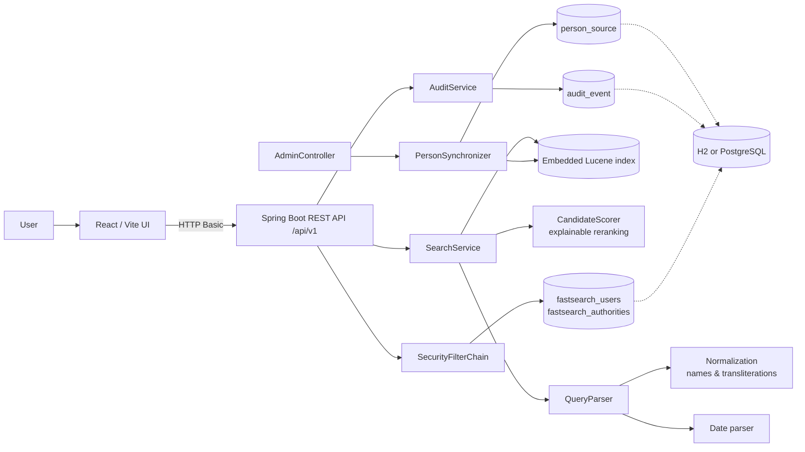
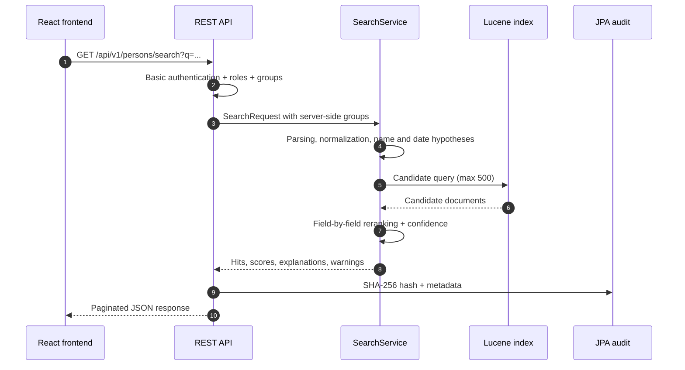
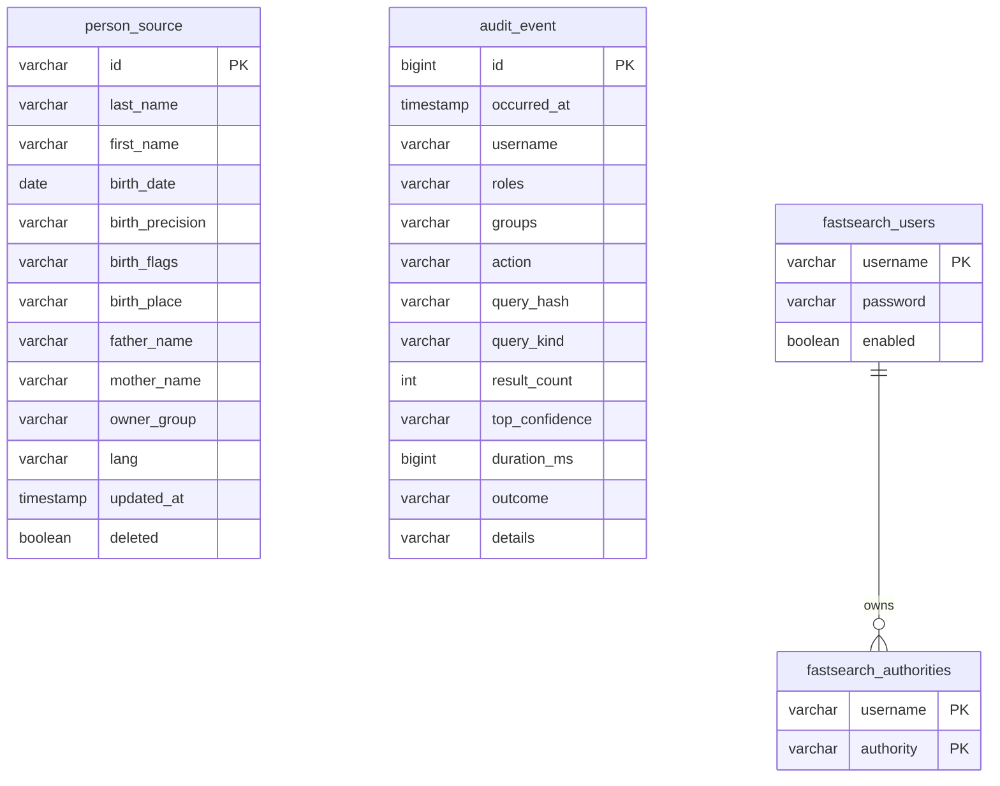

<div align="center">

# FastSearch Persons

**On-premise person matching engine — Arabic / Latin, explainable and access-isolated.**

**Version 0.1.0 — first public release.**

[](CHANGELOG.md)
[](https://openjdk.org/)
[](https://spring.io/projects/spring-boot)
[](https://lucene.apache.org/)
[](https://react.dev/)
[](https://www.typescriptlang.org/)
[](https://www.postgresql.org/)
[](LICENSE)
[](#tests-and-quality)
[](#limitations-and-caveats)

[Overview](#overview) · [Features](#features) · [Architecture](#architecture) · [Quick start](#quick-start) · [API](#rest-api) · [Data](#synthetic-data) · [Security](#security)

[Français](README_GITHUB.md) · **English**

</div>

---

> [!IMPORTANT]
> **All data in this project is synthetic.** The 196 people, their names,
> dates, places and identifiers are invented. No data comes from a real
> person, a civil registry file or an external database. The engine produces
> **candidates** with a score; it never performs automatic identification.

---

## Table of contents

- [Overview](#overview)
- [Features](#features)
- [Architecture](#architecture)
- [Technology stack](#technology-stack)
- [Quick start](#quick-start)
- [Demo accounts](#demo-accounts)
- [REST API](#rest-api)
- [Security](#security)
- [Synthetic data](#synthetic-data)
- [JDBC synchronization and indexing](#jdbc-synchronization-and-indexing)
- [Web interface](#web-interface)
- [Synthetic evaluation](#synthetic-evaluation)
- [Configuration](#configuration)
- [Tests and quality](#tests-and-quality)
- [Docker](#docker)
- [Repository structure](#repository-structure)
- [Limitations and caveats](#limitations-and-caveats)
- [License](#license)

---

## Overview

**FastSearch Persons** is a person search and matching engine designed to run
**entirely on-premise**, with no dependency on a cloud service. It combines:

- a **Java 17 / Spring Boot 3.3** backend;
- an embedded **Apache Lucene 9.12** search index;
- an **H2** relational database by default, or **PostgreSQL** under a dedicated
  profile;
- a versioned `/api/v1` REST API;
- a **React 18 / TypeScript / Vite / Tailwind CSS** web interface;
- **HTTP Basic** authentication without sessions, with roles and groups;
- a privacy-conscious **JPA** audit log;
- a reproducible **synthetic evaluation** module.

The project is designed for cases where the spellings of the same name vary:
Arabic/Latin transliterations, last name/first name inversion, filiation
particles, typos, OCR errors, incomplete dates or multiple numeric formats.

### Design principles

| Principle | Implementation |
|---|---|
| **The source database is the source of truth** | The Lucene index is a rebuildable artifact, synchronized from `person_source`. |
| **Candidates, never identification** | Each result exposes a score, a confidence level and an explanation; the decision remains human. |
| **Explainability** | Per-field details (last name, first name, date, place, identifier) are returned by the API and displayed in the UI. |
| **Isolation** | Read groups come from authentication, never from the request body. |
| **Minimization** | The audit log does not store the raw query, only a SHA-256 hash. |
| **Sovereignty** | No external API, no SaaS service, no mandatory telemetry. |
| **Reproducibility** | The evaluation dataset is deterministic for a given seed. |

### What this project is not

- It is not a biometric identification system.
- It is not a facial or voice recognition engine.
- It is not a database of real people.
- It is not a "production-ready" component without a security review, TLS,
  secrets management and a retention policy.

---

## Features

### 1. Multilingual Arabic / Latin search

- **Free-text** or **structured** search.
- Queries in Arabic, French or **mixed**.
- Arabic normalization: diacritics, tatweel, alif variants, ya/alif maqsura,
  ta marbuta, Arabic-Indic digits.
- Latin normalization: accents, ligatures, punctuation, apostrophes, hyphens
  and non-breaking spaces.
- Transliterations and first/last name variants via the embedded dictionary.
- Two phonetic keys (fine and coarse), fuzzy matching on the fine key and
  trigrams for close spellings.
- Handling of particles (`Ben`, `Bin`, `Ould`, `El`, `Al`, `بن`, `ولد`,
  `ابن`, `ال`, etc.) and Maghrebi surname prefixes.
- Automatic last name/first name inversion.
- Tolerance for typos and OCR errors.
- Search by source identifier.
- Search by birth date and birth place; parent names are indexed and displayed
  in the results.

### 2. Explainable matching

Each candidate returns:

- a **final score** normalized between 0 and 1, displayed out of 100 in the UI;
- a confidence level **`FORT`**, **`MOYEN`** or **`FAIBLE`**;
- a **per-field explanation** with match level and similarity;
- a global `reliable` flag;
- warnings when the query is ambiguous or limited.

The final score is not the raw Lucene score: it is recalculated field by field
by the reranker. Confidence rules are deliberately conservative:

- exact identifier → `FORT`;
- strong name, compatible date and no contradictory clue → `FORT`;
- **coarse** phonetic key or Arabic/Latin match not confirmed by the dictionary
  → never `FORT`;
- surname reduced to a particle with a single-token query → capped at `MOYEN`;
- date only, with no usable name → `FAIBLE`;
- `reliable = true` only if the top candidate is not `FAIBLE` and its score
  reaches `0.60`.

### 3. Smart date handling

Supported formats:

- `dd/mm/yyyy`, `dd-mm-yy`, mixed separators;
- ISO `yyyy-mm-dd`;
- compact `ddmmyyyy`, `ddmmyy`, `dmyyyy`, `dmyy` with handling of lost leading
  zeros;
- month names in French or Arabic;
- year only;
- month/year.

The parser:

- strictly validates the Gregorian calendar;
- rejects future or out-of-range dates;
- produces multiple weighted hypotheses when ambiguous;
- handles the century pivot via an injected clock;
- flags numeric ambiguity between date and identifier.

### 4. Group-based isolation

- Roles: `ADMIN`, `ANALYST`, `READER`.
- Groups: `GROUP_xxx` authorities from authentication.
- Lucene filter applied server-side.
- Second defensive check in the search service.
- The client cannot choose its groups in the JSON body or parameters.

### 5. Index administration

- Index statistics (documents, max doc, deleted, open state, path).
- Full reindex.
- Incremental synchronization by `updated_at`.
- Soft delete via the `deleted` column.
- Batch processing with a commit after each batch.
- No manual commit endpoint exposed.

### 6. Audit log

- `SEARCH`, `REINDEX`, `SYNC`, `EVAL` events.
- User, roles, groups, action, result, confidence, duration, outcome.
- SHA-256 hash of the query, never its raw text.
- Pagination and viewing restricted to `ADMIN`.
- Audit write failure does not make search unavailable.

### 7. Web interface

- Login screen.
- Session kept in `sessionStorage`, with no server cookie.
- Configurable backend URL; empty = same origin via the Vite proxy.
- Structured or free-text search.
- Result cards with score, confidence, language, group, date, place, parents and
  identifier.
- Automatic RTL display for Arabic names.
- Side detail drawer with full explanation.
- Local confidence filter on the current page.
- Pagination and page-size selection.
- JSON export of displayed results.
- Admin panel (index + audit) restricted to `ADMIN`.
- Evaluation panel restricted to `ADMIN` and `ANALYST`.
- No demo/mock mode: all data comes from the real API.

### 8. Synthetic evaluation

- Deterministically generated case set from a seed.
- Temporary index, never the production index.
- Metrics: Recall@10, MRR, nDCG@10, precision@1, false `FORT` rate.
- Per-category metrics: exact, inversion, Arabic, transliteration, typo, date,
  homonyms.
- Simulated SQL `LIKE` baseline.
- Optional OpenSearch baseline, reported unavailable if not configured.
- Dictionary row suggestions, never applied automatically.

---

## Architecture

### Logical view



### Search flow



### Main data model



---

## Technology stack

| Layer | Technology | Version / role |
|---|---|---|
| Backend language | Java | 17 |
| Framework | Spring Boot | 3.3.13 |
| Web | Spring MVC, Bean Validation | REST API, DTOs, structured errors |
| Security | Spring Security | HTTP Basic, roles, groups, BCrypt |
| Persistence | Spring Data JPA + JDBC | JPA audit, batched JDBC source |
| Search | Apache Lucene | 9.12.2, embedded index |
| Databases | H2 / PostgreSQL | H2 by default, PostgreSQL under a profile |
| Tests | JUnit 5, Spring Boot Test, ArchUnit | 62 tests |
| Build | Maven | single `pom.xml` |
| Frontend | React 18, TypeScript 5.5 | SPA interface |
| Frontend build | Vite 7 | dev server, proxy, build |
| Styling | Tailwind CSS 3 | responsive UI |
| Icons | Lucide React | iconography |
| Containers | Docker, Docker Compose | PostgreSQL 16 + application |

### Architectural constraints

The following packages are deliberately **independent of Spring and JPA**:

```text
com.fastsearch.persons.analysis
com.fastsearch.persons.names
com.fastsearch.persons.dates
com.fastsearch.persons.search
```

An **ArchUnit** test enforces this rule. The goal is to keep the engine core
testable and reusable outside the Spring context.

---

## Quick start

### Prerequisites

- JDK 17;
- Maven 3.9+;
- Node.js 20+ and npm for the web interface;
- PostgreSQL 16+ (optional, for the `postgres` profile);
- Docker and Docker Compose (optional).

### Backend with H2 (default)

```bash
mvn clean test
mvn package
java -jar target/fastsearch-persons.jar
```

By default:

- H2 file database in `./data/fastsearch`;
- Lucene index in `./data/index`;
- **196 synthetic people** inserted at startup;
- API on `http://localhost:8080`.

Verification:

```bash
curl http://localhost:8080/actuator/health
```

To start from an empty database, stop the application and delete `./data`.

### Backend with PostgreSQL

Create a database and a role (adapt to your installation):

```bash
psql -U postgres -c "CREATE USER fastsearch WITH PASSWORD 'fastsearch';"
psql -U postgres -c "CREATE DATABASE fastsearch OWNER fastsearch;"
```

Launch with the `postgres` profile:

```bash
export SPRING_PROFILES_ACTIVE=postgres
export FASTSEARCH_DB_URL=jdbc:postgresql://localhost:5432/fastsearch
export FASTSEARCH_DB_USER=fastsearch
export FASTSEARCH_DB_PASSWORD=fastsearch
java -jar target/fastsearch-persons.jar
```

In PowerShell:

```powershell
$env:SPRING_PROFILES_ACTIVE = 'postgres'
$env:FASTSEARCH_DB_URL = 'jdbc:postgresql://localhost:5432/fastsearch'
$env:FASTSEARCH_DB_USER = 'fastsearch'
$env:FASTSEARCH_DB_PASSWORD = 'fastsearch'
java -jar target\fastsearch-persons.jar
```

The `postgres` profile:

- enables demo data by default;
- creates and seeds the `fastsearch_users` and `fastsearch_authorities`
  identity tables;
- uses the JDBC identity store (`fastsearch.security.store: jdbc`);
- preserves existing accounts: a restart does not overwrite an existing
  password or authority.

### Import the SQL export

The file [`db/person_source_data.sql`](db/person_source_data.sql) contains the
**196 INSERT** statements for `public.person_source`, wrapped in a transaction.

```bash
psql -U fastsearch -d fastsearch -f db/person_source_data.sql
```

> [!NOTE]
> Import this file into an **empty** database, or uncomment the `TRUNCATE`
> statement in the header if the table already contains the data. If the
> application has already started with demo data, the 196 rows are already
> present: the initializer is idempotent by `id`.

Verification:

```sql
SELECT COUNT(*) FROM public.person_source;
-- 196

SELECT lang, COUNT(*)
FROM public.person_source
GROUP BY lang
ORDER BY lang;
-- ar: 103
-- fr: 93
```

### Web interface

In the associated frontend project:

```bash
npm install
npm run dev
```

The Vite proxy forwards `/api` and `/actuator` to `http://localhost:8080` by
default. To target another backend:

```bash
FASTSEARCH_BACKEND_URL=http://localhost:18080 npm run dev
```

In PowerShell:

```powershell
$env:FASTSEARCH_BACKEND_URL = 'http://localhost:18080'
npm run dev
```

Then open the URL shown by Vite (usually `http://localhost:5173`).

### Docker Compose

```bash
docker compose up --build
```

The composition starts:

- **PostgreSQL 16** with the `pgdata` volume;
- the Spring Boot application with the `postgres` profile;
- the Lucene index in the `indexdata` volume;
- demo data enabled by default.

```bash
# Stop without losing volumes
docker compose down

# Stop and remove volumes (data loss)
docker compose down -v
```

To disable synthetic data:

```bash
FASTSEARCH_DEMO_ENABLED=false docker compose up --build
```

---

## Demo accounts

> [!WARNING]
> These accounts are **public and intended for local demonstration only**.
> Replace them before any deployment. The `@fastsearch.test` addresses are
> fictitious.

| User | Password | Role | Groups |
|---|---|---|---|
| `benkkadour.khaled@gmail.com` | `KHALED123` | `ADMIN` | A, B |
| `amina.benali@fastsearch.test` | `Amina-Analyste-2026` | `ANALYST` | A |
| `yassine.merabet@fastsearch.test` | `Yassine-Analyste-2026` | `ANALYST` | B |
| `sara.haddad@fastsearch.test` | `Sara-Lecteur-2026` | `READER` | A |
| `karim.bouzid@fastsearch.test` | `Karim-Lecteur-2026` | `READER` | B |

In the PostgreSQL profile, these accounts are persisted in the
`fastsearch_users` and `fastsearch_authorities` tables with **BCrypt**
passwords. In memory (H2 default), they are loaded from the
`fastsearch.security.users` configuration.

---

## REST API

Base: `http://localhost:8080/api/v1`

| Method | Path | Access | Description |
|---|---|---|---|
| `GET` | `/actuator/health`, `/actuator/info` | Public | Health and information |
| `GET` | `/actuator/**` | `ADMIN` | Metrics and other endpoints |
| `GET` | `/api/v1/auth/me` | Authenticated | Identity, roles and groups |
| `GET` | `/api/v1/persons/search` | `ADMIN`, `ANALYST`, `READER` | Search by parameters |
| `POST` | `/api/v1/persons/search` | `ADMIN`, `ANALYST`, `READER` | Structured JSON search |
| `GET` | `/api/v1/admin/index/stats` | `ADMIN` | Index statistics |
| `POST` | `/api/v1/admin/index/reindex` | `ADMIN` | Full reindex |
| `POST` | `/api/v1/admin/index/sync` | `ADMIN` | Incremental synchronization |
| `GET` | `/api/v1/admin/audit` | `ADMIN` | Paginated audit log |
| `POST` | `/api/v1/eval/run` | `ADMIN`, `ANALYST` | Synthetic evaluation |

### Free-text search

```bash
curl -u sara.haddad@fastsearch.test:Sara-Lecteur-2026 \
  --get --data-urlencode 'q=Oualid Benali 07/04/1992' \
  http://localhost:8080/api/v1/persons/search
```

Arabic example:

```bash
curl -u sara.haddad@fastsearch.test:Sara-Lecteur-2026 \
  --get --data-urlencode 'q=وليد بن علي' \
  http://localhost:8080/api/v1/persons/search
```

### Structured search

```bash
curl -u sara.haddad@fastsearch.test:Sara-Lecteur-2026 \
  -H 'Content-Type: application/json' \
  -d '{
        "lastName": "Benali",
        "firstName": "Walid",
        "birthDate": "07/04/1992",
        "birthPlace": "Alger",
        "page": 0,
        "size": 20,
        "includeExplanation": true
      }' \
  http://localhost:8080/api/v1/persons/search
```

### Parameters

| Parameter | Type | Default | Role |
|---|---|---|---|
| `q` | string | — | Free-text query (name, date, identifier) |
| `lastName` | string | — | Last name |
| `firstName` | string | — | First name |
| `birthDate` | string | — | Birth date |
| `birthPlace` | string | — | Birth place |
| `page` | int | `0` | Page, 0-based on the API side |
| `size` | int | `20` | Page size, server maximum `100` |
| `explain` / `includeExplanation` | boolean | `true` | Include explanations |

### Response

```json
{
  "hits": [
    {
      "id": "D001",
      "lastName": "Benali",
      "firstName": "Walid",
      "fullName": "Benali Walid",
      "birthDate": "1992-04-07",
      "birthPrecision": "JOUR",
      "birthPlace": "Alger",
      "fatherName": "",
      "motherName": "",
      "ownerGroup": "A",
      "lang": "fr",
      "score": 1.0,
      "confidence": "FORT",
      "explanations": [
        {
          "field": "nom",
          "level": "EXACT",
          "detail": "comparaison directe : exact",
          "score": 1.0
        }
      ]
    }
  ],
  "total": 1,
  "page": 0,
  "size": 20,
  "reliable": true,
  "message": "Candidats proposés ; aucun résultat ne constitue une identification.",
  "warnings": []
}
```

> API messages and explanation details are currently returned in French.
> Field names and enum values (`FORT`, `MOYEN`, `FAIBLE`, `JOUR`, etc.) are
> part of the API contract.

### Identity

```bash
curl -u sara.haddad@fastsearch.test:Sara-Lecteur-2026 \
  http://localhost:8080/api/v1/auth/me
```

```json
{
  "username": "sara.haddad@fastsearch.test",
  "roles": ["READER"],
  "groups": ["A"]
}
```

### Administration

```bash
# Statistics
curl -u benkkadour.khaled@gmail.com:KHALED123 \
  http://localhost:8080/api/v1/admin/index/stats

# Full reindex
curl -u benkkadour.khaled@gmail.com:KHALED123 -X POST \
  http://localhost:8080/api/v1/admin/index/reindex

# Incremental synchronization
curl -u benkkadour.khaled@gmail.com:KHALED123 -X POST \
  'http://localhost:8080/api/v1/admin/index/sync?full=false&since=2026-01-01T00:00:00Z&batchSize=500'

# Audit log
curl -u benkkadour.khaled@gmail.com:KHALED123 \
  'http://localhost:8080/api/v1/admin/audit?page=0&size=50'
```

### Evaluation

```bash
curl -u amina.benali@fastsearch.test:Amina-Analyste-2026 -X POST \
  'http://localhost:8080/api/v1/eval/run?seed=42&count=24'
```

### Error codes

| Code | Meaning |
|---|---|
| `400` | Invalid request, field too long or malformed JSON |
| `401` | Missing or invalid authentication |
| `403` | Insufficient role or unauthorized group |
| `404` | Unknown resource |
| `500` | Internal error |

---

## Security

### Authentication and authorization

- **HTTP Basic** on every request.
- Server sessions **disabled** (`STATELESS`).
- **BCrypt** passwords.
- Roles `ADMIN`, `ANALYST`, `READER`.
- Group authorities `GROUP_A`, `GROUP_B`, etc.
- URL and method security (`@PreAuthorize`).
- Explicit CORS for local Vite origins.
- `WWW-Authenticate` header exposed to the frontend.

### Data isolation

The client never supplies its groups. The controller extracts them from the
`Authentication` object:

```java
Set<String> groups = currentUser.groups(authentication);
SearchRequest request = body.toSearchRequest(groups);
```

The filter is applied in the Lucene query, then checked a second time in
`SearchService` before reranking.

### Audit and privacy

The log stores:

- the user, roles and groups;
- the action and its result;
- the number of results, the top hit confidence and the duration;
- a **SHA-256 hash** of the query.

It **never** stores:

- the raw query text;
- name, first name, date or place values;
- Lucene documents.

### Recommended hardening before production

- Put the application behind **HTTPS/TLS**.
- Replace demo accounts.
- Use a secrets manager.
- Restrict CORS origins.
- Add rate limiting and a reverse proxy.
- Replace `ddl-auto=update` with versioned migrations (Flyway/Liquibase).
- Implement an audit retention and purge policy.
- Protect the UI against XSS, because the Basic header is kept in
  `sessionStorage`.
- Perform a security review and load tests on the real corpus.

---

## Synthetic data

### Composition

| Indicator | Value |
|---|---|
| People | **196** |
| Identifiers | `D001` to `D196` |
| Arabic (`lang = ar`) | **103** |
| Latin script (`lang = fr`) | **93** |
| Group A | **127** |
| Group B | **69** |
| Lucene index | **196 documents** |
| SQL export | **196 INSERT statements** |

The data deliberately covers:

- Arabic and Latin names;
- transliterations and variants;
- particles (`Ben`, `Ould`, `El`, `بن`, `ولد`, etc.);
- dates with `JOUR`, `MOIS`, `ANNEE` precision;
- places in Arabic and French;
- homonyms and people in the same group;
- a protected record (`D005`) to verify isolation;
- people distributed across groups A and B.

### SQL file

The file [`db/person_source_data.sql`](db/person_source_data.sql) is a cleaned
`pg_dump --data-only --column-inserts` export:

- UTF-8 without BOM;
- 196 `INSERT` statements into `public.person_source`;
- `BEGIN;` / `COMMIT;` transaction;
- no non-portable `\restrict` / `\unrestrict`;
- no `SET transaction_timeout`;
- documented header and import instructions.

Sample content:

```sql
INSERT INTO public.person_source (
  id, last_name, first_name, birth_date, birth_precision, birth_flags,
  birth_place, father_name, mother_name, owner_group, lang, updated_at, deleted
) VALUES (
  'D097', 'عثماني', 'عبد الحق', '1988-02-12', 'JOUR', '',
  'الجزائر', 'محمد', 'فاطمة', 'A', 'ar', '2026-11-12 09:43:33.426976', false
);
```

### `person_source` schema

| Column | Type | Role |
|---|---|---|
| `id` | `varchar(32)` PK | Source identifier |
| `last_name` | `varchar(100)` | Last name |
| `first_name` | `varchar(100)` | First name |
| `birth_date` | `date` | Birth date |
| `birth_precision` | `varchar(16)` | `JOUR`, `MOIS`, `ANNEE` |
| `birth_flags` | `varchar(100)` | Ambiguity markers |
| `birth_place` | `varchar(100)` | Birth place |
| `father_name` | `varchar(100)` | Father's name |
| `mother_name` | `varchar(100)` | Mother's name |
| `owner_group` | `varchar(32)` | Read group |
| `lang` | `varchar(8)` | Language (`ar`, `fr`) |
| `updated_at` | `timestamp` | Incremental synchronization |
| `deleted` | `boolean` | Soft delete |

### Demo initialization

`DemoDataInitializer` inserts the 196 rows **idempotently by `id`**, then
rebuilds the index if needed. A restart does not create duplicates.

To disable demo data:

```bash
FASTSEARCH_DEMO_ENABLED=false java -jar target/fastsearch-persons.jar
```

---

## JDBC synchronization and indexing

### How it works

1. Read `person_source` via `PreparedStatement`.
2. `setFetchSize` to bound driver-side memory.
3. Batch processing (`fastsearch.sync.batch-size`, default `500`).
4. Write upserts and deletes to Lucene.
5. `commit()` after each batch.
6. Final report: rows read, documents indexed, deleted, batches, last
   identifier, warnings.

### SQL safety

- Table and column names are validated by regular expression.
- Identifiers are quoted.
- Values are always bound through `PreparedStatement`.
- No user value is concatenated into SQL.

### Modes

| Mode | Behavior |
|---|---|
| `FULL` | Clears the index then re-reads the entire source |
| `INCREMENTAL` | Reads rows where `updated_at >= since` |
| `INCREMENTAL` without `since` | Reads from the beginning and adds a warning |

Rows with `deleted = true` are removed from the index.

### Synchronization API

```bash
# Full reindex
curl -u benkkadour.khaled@gmail.com:KHALED123 -X POST \
  http://localhost:8080/api/v1/admin/index/reindex

# Incremental
curl -u benkkadour.khaled@gmail.com:KHALED123 -X POST \
  'http://localhost:8080/api/v1/admin/index/sync?full=false&since=2026-01-01T00:00:00Z&batchSize=500'
```

---

## Web interface

The React/Vite interface is the reference client for the API. It contains
**no mock mode**: every screen calls the real backend.

### Screens and components

| Component | Function |
|---|---|
| `LoginScreen` | HTTP Basic login, credential validation |
| `SearchForm` | Structured or free-text search |
| `ResultCard` | Score, confidence, language, group, dates, parents, explanations |
| `PersonDrawer` | Full side detail for the candidate |
| `Pagination` | Navigation and page size |
| `AdminPanel` | Statistics, reindex, synchronization |
| `AuditLogPanel` | Paginated log, hash, duration, outcome |
| `EvalPanel` | Metrics, categories, baselines, suggestions |
| `SettingsBar` | Backend URL, role, logout |
| `CandidateBanner` | "Candidate, not identification" reminder |

### User journey

1. Log in with a demo account.
2. Enter a free-text or structured search.
3. View candidates sorted by score.
4. Filter locally by confidence.
5. Open the detail drawer and read the explanations.
6. Export the current page as JSON.
7. Access administration or evaluation depending on the role.

### UX details

- Arabic names displayed in automatic **RTL**.
- Scores out of 100 with a progress bar.
- Colored confidence badges (`FORT`, `MOYEN`, `FAIBLE`).
- Visible warnings when the result is unreliable.
- Keyboard navigation on result cards.
- Accessible drawer (`role="dialog"`, `aria-modal`).
- Responsive Tailwind interface.
- No real personal data displayed.

### Backend configuration

- Empty field = same origin, Vite proxy.
- Absolute URL = direct call to the backend.
- Changing the URL clears the session so Basic credentials are never reused
  against another server.
- Session kept in `sessionStorage` for the current tab.

---

## Synthetic evaluation

Evaluation is an **internal measurement** tool, not proof of performance on
real data.

### What is measured

- **Recall@10**: proportion of cases where the correct person is in the top 10.
- **MRR**: mean reciprocal rank of the first relevant result.
- **nDCG@10**: ranking quality.
- **Precision@1**: proportion of correct first results.
- **False `FORT` rate**: strong confidence assigned to a wrong candidate.
- Per-category metrics.

### Categories

| Category | Example |
|---|---|
| `exact` | Identical last name and first name |
| `inversion` | Last name/first name swapped |
| `arabic` | Query in Arabic |
| `transliteration` | `Walid` / `Oualid` / `وليد` |
| `typo` | Typo or OCR error |
| `date` | Full, partial or ambiguous date |
| `homonym` | Several close people |

### Baselines

- **Simulated SQL `LIKE`**: naive comparison.
- **OpenSearch**: optional, via `fastsearch.eval.open-search-url`.
  If not configured, it is reported **unavailable** without fabricating
  metrics.

### Dictionary suggestions

The report may propose `canonical ← observed` rows with an occurrence count.
These proposals are intended for **human review**; no automatic change is
applied.

### Example

```bash
curl -u amina.benali@fastsearch.test:Amina-Analyste-2026 -X POST \
  'http://localhost:8080/api/v1/eval/run?seed=42&count=12'
```

With `count=12`, the dataset produces 15 people and 75 cases. With `count=24`,
it produces 27 people and 147 cases. Results are reproducible for a given seed.

---

## Configuration

### Server properties

| Property | Default | Role |
|---|---|---|
| `server.port` | `8080` | HTTP port |
| `fastsearch.index.path` | `./data/index` | Lucene index directory |
| `fastsearch.dictionary-path` | empty | External CSV; empty = embedded dictionary |
| `fastsearch.search.candidate-limit` | `500` | Maximum Lucene candidates reranked |
| `fastsearch.search.max-page-size` | `100` | Maximum page size |
| `fastsearch.search.enable-coarse` | `true` | Enables the coarse phonetic key |
| `fastsearch.sync.batch-size` | `500` | Default JDBC batch size |
| `fastsearch.sync.table` | `person_source` | Source table |
| `fastsearch.sync.*-column` | standard columns | Column mapping |
| `fastsearch.eval.seed` | `42` | Default seed |
| `fastsearch.eval.count` | `40` | Default case count (12 to 120) |
| `fastsearch.eval.open-search-url` | empty | Optional OpenSearch baseline |
| `fastsearch.demo.enabled` | `true` | Synthetic data at startup |
| `fastsearch.security.store` | `memory` | `memory` or `jdbc` |
| `fastsearch.security.default-users` | `false` | Fallback accounts if no user exists |
| `fastsearch.security.users` | test accounts | Explicit users |
| `fastsearch.cors.allowed-origins` | Vite origins | Allowed CORS origins |

### PostgreSQL environment variables

| Variable | Default |
|---|---|
| `SPRING_PROFILES_ACTIVE` | `postgres` |
| `FASTSEARCH_DB_URL` | `jdbc:postgresql://localhost:5432/fastsearch` |
| `FASTSEARCH_DB_USER` | `fastsearch` |
| `FASTSEARCH_DB_PASSWORD` | `fastsearch` |
| `FASTSEARCH_INDEX_PATH` | `./data/index` |
| `FASTSEARCH_DEMO_ENABLED` | `true` |
| `FASTSEARCH_SECURITY_STORE` | `jdbc` |

### `application-postgres.yml` example

The profile is already provided. Sensitive values must be replaced with
environment variables or a secrets manager.

---

## Tests and quality

### Backend

```bash
mvn test
```

The suite notably covers:

- name normalization and dictionary;
- phonetic keys and variants;
- date parsing and matching;
- scoring and confidence levels;
- JDBC synchronization and deletions;
- synthetic evaluation;
- security, roles, groups and CORS;
- audit without raw queries;
- REST API and validation;
- ArchUnit rules.

**Verified on 2026-11-12: 62 tests, 0 failures.**

### Frontend

```bash
npm run typecheck
npm run lint
npm run build
```

### Integration checks

| Check | Result |
|---|---|
| Backend tests | 62 / 62 |
| Lucene index | 196 documents |
| PostgreSQL `person_source` | 196 rows |
| SQL export | 196 valid INSERT statements |
| Frontend typecheck | OK |
| Frontend lint | OK |
| Frontend build | OK |
| Browser test | Login, search, explanations, administration, audit |

> Frontend and browser tests do not replace a versioned E2E suite in the
> repository. They document the verified state of the demonstration.

---

## Docker

### Build

```bash
docker compose up --build
```

### Services

| Service | Image | Role |
|---|---|---|
| `postgres` | `postgres:16-alpine` | Database |
| `fastsearch` | local build | Spring Boot application |

### Volumes

- `pgdata`: PostgreSQL data;
- `indexdata`: Lucene index.

### Health

The `Dockerfile` exposes a `HEALTHCHECK` on
`http://127.0.0.1:8080/actuator/health`.

### Shutdown

```bash
docker compose down       # keep volumes
docker compose down -v    # remove volumes
```

---

## Repository structure

```text
backend/
├── db/
│   └── person_source_data.sql       # export of the 196 people
├── src/
│   ├── main/
│   │   ├── java/com/fastsearch/persons/
│   │   │   ├── analysis/            # Lucene analyzers
│   │   │   ├── api/                 # controllers, DTOs, errors
│   │   │   ├── audit/               # JPA audit log
│   │   │   ├── config/              # Spring wiring, demo data
│   │   │   ├── dates/               # date parser and matcher
│   │   │   ├── eval/                # synthetic evaluation
│   │   │   ├── names/               # normalization, dictionary, phonetics
│   │   │   ├── search/              # index, queries, scoring
│   │   │   ├── security/            # HTTP Basic, roles, groups
│   │   │   └── sync/                # JDBC -> Lucene
│   │   └── resources/
│   │       ├── application.yml
│   │       └── application-postgres.yml
│   └── test/                        # JUnit 5, Spring Boot Test, ArchUnit
├── docker-compose.yml
├── Dockerfile
├── CHANGELOG.md
├── LICENSE
├── LIMITS.md
├── README.md
├── README_GITHUB.md
└── README_GITHUB_EN.md

frontend/
├── src/
│   ├── components/                  # screens and UI components
│   ├── lib/                         # API client, auth, display
│   ├── App.tsx
│   └── types.ts
├── CHANGELOG.md
├── LICENSE
├── README.md
├── README_EN.md
├── package.json
└── vite.config.ts
```

> The two projects can be published in the same repository (`backend/` and
> `frontend/` folders) or in two separate repositories. Adapt the paths and
> the Vite proxy to your layout.

---

## Limitations and caveats

- **Heuristics**: the dictionary, phonetic rules and confidence thresholds are
  heuristics that require curation. They do not replace domain expertise.
- **Homonyms**: two people may share the same name; a date, a place or parents
  are needed for corroboration.
- **No biometrics**: no face, no fingerprint, no voice.
- **No real data**: the 196-person dataset is entirely synthetic.
- **Performance**: evaluation metrics are based on a synthetic dataset and do
  not predict performance on a real corpus.
- **HTTP Basic**: must be used behind TLS. The header is kept in
  `sessionStorage` on the frontend, which exposes it to XSS risk.
- **Demo accounts**: remove or replace before any deployment.
- **Migrations**: `ddl-auto=update` is convenient for demonstrations, but real
  production use should rely on Flyway or Liquibase.
- **Rate limiting**: not provided; add it at the reverse proxy or application
  level.
- **Observability**: Actuator exposes `health`, `info`, `metrics`; a
  metrics/tracing stack remains to be integrated depending on the environment.
- **OpenSearch**: the baseline is optional and not bundled.

### Interpretation rule

> A high score does not mean "confirmed identity". It means "high similarity
> between the query and a record". Any decision must be made by a human, with
> business context and the necessary corroboration.

---

## License

This project is released under the **MIT License**. See [LICENSE](LICENSE).

Copyright (c) 2026 FastSearch Persons contributors.

The MIT License allows use, modification, distribution and sublicensing of the
code, including for commercial purposes, provided that the copyright notice
and the warranty disclaimer are retained.

> The synthetic data and documentation are provided as examples. Before any
> deployment involving real data, verify the applicable legal obligations
> (data protection, retention, access, etc.).

---

<div align="center">

**FastSearch Persons** — candidate search, not identification.

100% synthetic data · MIT License · REST API v1 · Java 17 · Spring Boot · Lucene · React

</div>
