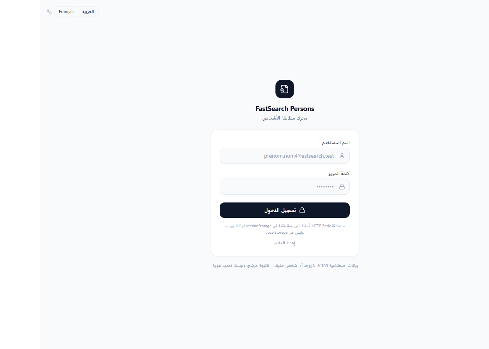
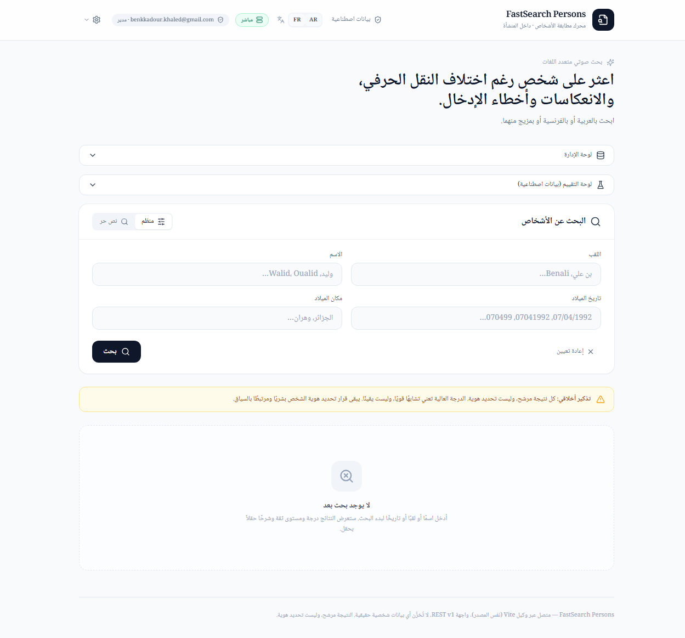
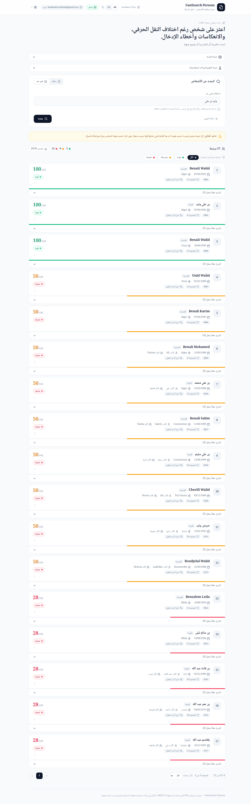
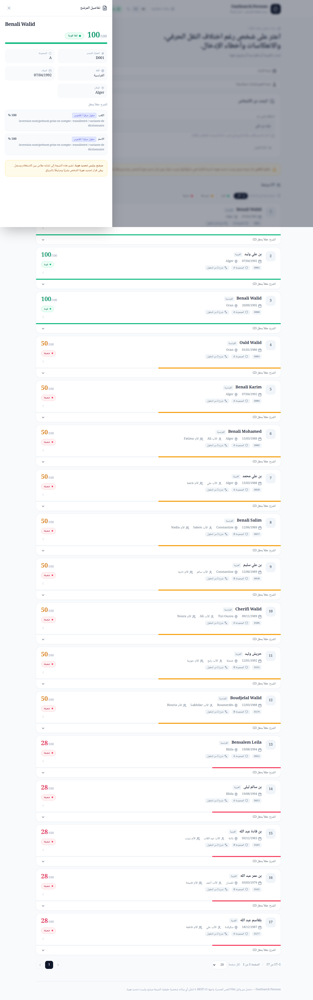
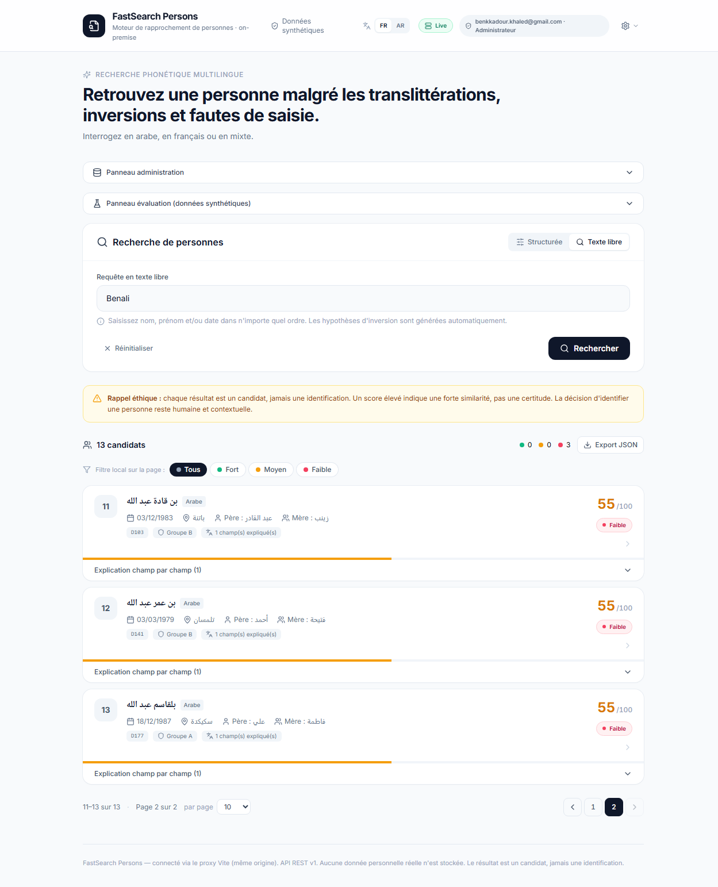
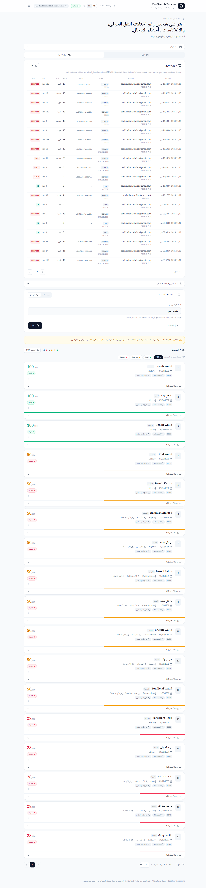

# Documentation — FastSearch Persons

Bienvenue dans la documentation du monorepo **FastSearch Persons**. Ce dossier
centralise les guides techniques, la référence API et les informations de
déploiement pour le backend et le frontend.

> [!IMPORTANT]
> Toutes les personnes, tous les noms, toutes les dates et tous les
> identifiants livrés avec le projet sont **synthétiques**. Le moteur produit
> des **candidats** avec un score ; il ne réalise jamais une identification
> automatique.

## Parcours de lecture

| Vous êtes… | Commencez par… |
|---|---|
| Curieux du projet | [README principal](../README.md) puis [Architecture](architecture.md) |
| Développeur backend | [Guide backend](backend.md) puis [Référence API](api.md) |
| Développeur frontend | [Guide frontend](frontend.md) puis [Architecture](architecture.md) |
| Responsable déploiement | [Déploiement](deployment.md) puis [Limites](limitations.md) |
| Responsable sécurité | [Politique de sécurité](../SECURITY.md) puis [Architecture](architecture.md#sécurité) |
| Contributeur | [Guide de contribution](../CONTRIBUTING.md) |

## Sommaire de la documentation

| Document | Contenu |
|---|---|
| [Architecture](architecture.md) | Principes, composants, flux de recherche, modèle de données, sécurité et choix techniques |
| [Backend](backend.md) | Stack Java/Spring Boot/Lucene, structure, configuration, synchronisation, audit et évaluation |
| [Référence API](api.md) | Authentification, endpoints, paramètres, réponses, pagination et erreurs |
| [Frontend](frontend.md) | Interface React, i18n FR/AR, RTL, pagination, accessibilité et Docker Nginx |
| [Frontend — English](frontend-en.md) | English version of the frontend guide |
| [Backend — English](backend-en.md) | English overview of the backend |
| [Déploiement](deployment.md) | Docker Compose, PostgreSQL, Nginx, TLS, sauvegardes et checklist de production |
| [Limites connues](limitations.md) | Ce que le moteur ne garantit pas et précautions d'usage |
| [Journal des modifications](../CHANGELOG.md) | Historique des versions du monorepo |
| [Sécurité](../SECURITY.md) | Signalement des vulnérabilités et socle de sécurité |
| [Contribution](../CONTRIBUTING.md) | Environnement de développement, conventions et checklist de PR |
| [Code de conduite](../CODE_OF_CONDUCT.md) | Règles de collaboration |

## Captures d'écran

| Écran | Aperçu |
|---|---|
| Connexion (arabe) |  |
| Recherche (arabe, RTL) |  |
| Résultats (arabe) |  |
| Fiche candidat (arabe) |  |
| Pagination (français) |  |
| Journal d'audit (arabe) |  |

## Conventions du projet

- **Langue de l'interface** : français et arabe, avec bascule RTL automatique.
- **Langue de la documentation** : français pour les guides de référence,
  anglais pour les synthèses et les lecteurs internationaux.
- **Données** : uniquement des données synthétiques dans le dépôt.
- **Résultats** : toujours présentés comme des candidats, jamais comme des
  identifications.
- **Sécurité** : HTTP Basic derrière TLS, comptes de démonstration à remplacer,
  audit minimisé.
- **Qualité** : tests backend et frontend, CI GitHub Actions, vérification des
  liens Markdown.

## Maintenir la documentation

1. Toute évolution fonctionnelle doit mettre à jour le guide concerné et le
   [journal des modifications](../CHANGELOG.md).
2. Les liens relatifs sont vérifiés automatiquement :
   `node scripts/check-markdown-links.mjs`.
3. Les captures d'écran sont stockées dans `docs/screenshots/` et référencées
   avec un texte alternatif descriptif.
4. Ne jamais inclure de données personnelles réelles, de secrets ou
   d'identifiants de production dans la documentation.
