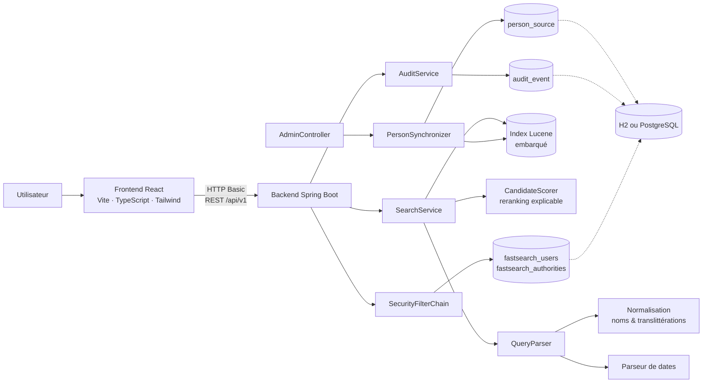
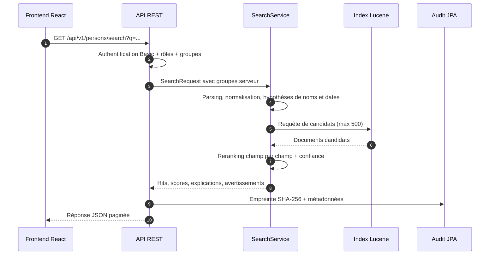
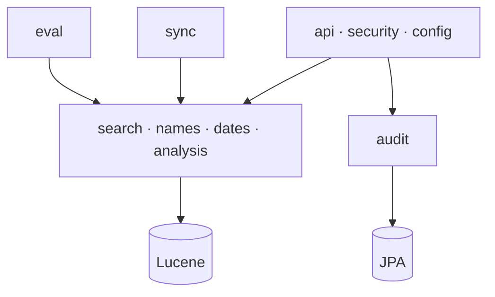
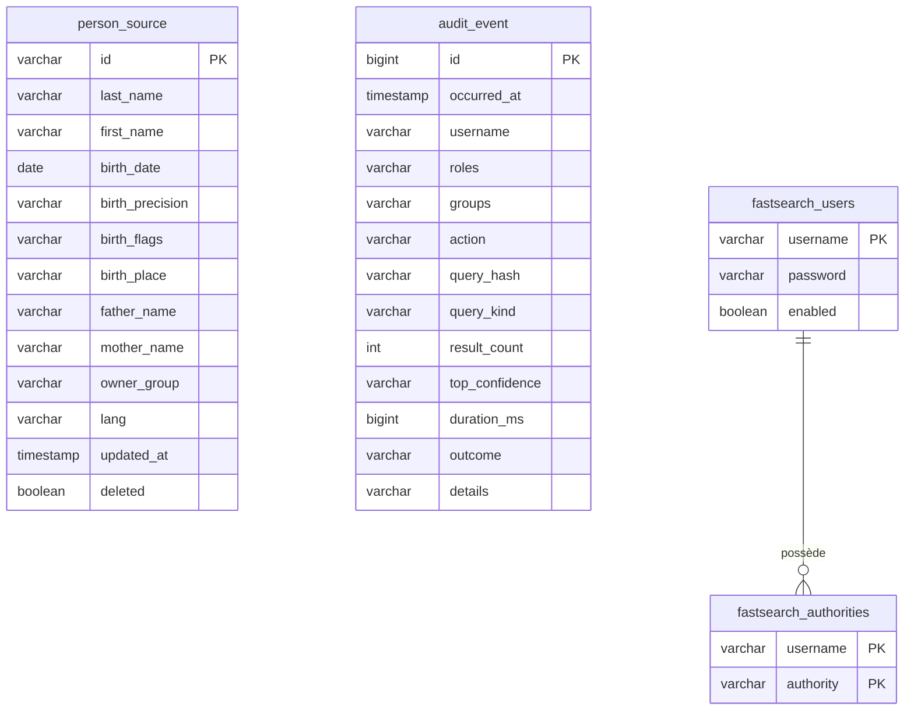
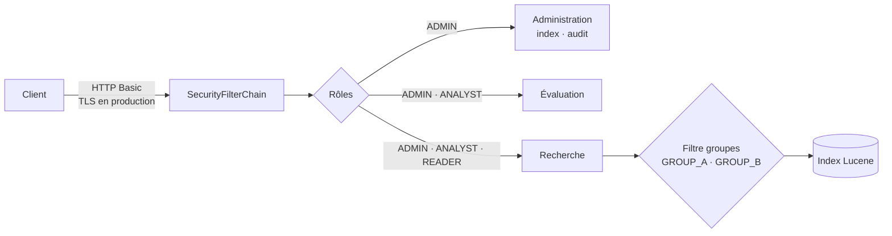
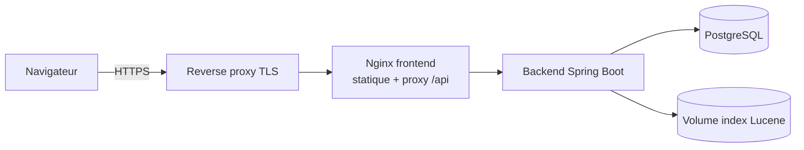

# Architecture

Ce document décrit l'architecture logique et technique de **FastSearch Persons**.
Il s'adresse aux développeurs, aux architectes et aux équipes qui doivent
exploiter ou auditer le moteur.

## 1. Objectif et principes

FastSearch Persons est un moteur **on-premise** de recherche et de
rapprochement de personnes. Il est conçu pour les corpus où les graphies d'un
même nom varient : translittérations arabe/latin, inversion nom/prénom,
particules de filiation, fautes de frappe, erreurs OCR, dates incomplètes ou
formats numériques multiples.

Le moteur ne rend jamais une identification. Il classe des **candidats** et
expose les éléments qui permettent à un humain de décider.

| Principe | Mise en œuvre |
|---|---|
| **La base source est la vérité** | L'index Lucene est un artefact reconstructible, synchronisé depuis `person_source`. |
| **Candidat, jamais identification** | Chaque résultat expose un score, une confiance et une explication ; la décision reste humaine. |
| **Explicabilité** | Le détail par champ (nom, prénom, date, lieu, identifiant) est renvoyé par l'API et affiché dans l'interface. |
| **Cloisonnement** | Les groupes de lecture viennent de l'authentification, jamais du corps de la requête. |
| **Minimisation** | L'audit ne stocke pas la requête brute, seulement une empreinte SHA-256. |
| **Souveraineté** | Aucune API externe, aucun service SaaS, aucune télémétrie obligatoire. |
| **Reproductibilité** | Le jeu d'évaluation est déterministe pour une graine donnée. |

### Ce que le projet n'est pas

- Ce n'est pas un système d'identification biométrique.
- Ce n'est pas un moteur de reconnaissance faciale ou vocale.
- Ce n'est pas une base de personnes réelles.
- Ce n'est pas un composant « prêt pour la production » sans revue de sécurité,
  TLS, gestion de secrets et politique de conservation.

## 2. Vue d'ensemble



### Composants principaux

| Composant | Responsabilité |
|---|---|
| `frontend/` | SPA React bilingue FR/AR, client de référence de l'API, aucun mock. |
| `backend/` | API REST v1, moteur de recherche, sécurité, audit, synchronisation, évaluation. |
| Index Lucene | Index inversé embarqué, reconstructible depuis la base source. |
| Base relationnelle | H2 en local, PostgreSQL en production ; stocke la source, l'audit et les identités. |
| `person_source` | Table source de vérité pour les personnes. |
| `audit_event` | Journal d'audit minimisé, avec empreinte SHA-256. |

## 3. Flux d'une recherche



### Étapes détaillées

1. **Authentification** : Spring Security valide les identifiants HTTP Basic et
   construit les autorités `ROLE_*` et `GROUP_*`.
2. **Extraction des groupes** : le contrôleur lit les groupes depuis
   `Authentication`. Le client ne peut pas les fournir.
3. **Parsing de la requête** : `QueryParser` distingue recherche libre et
   recherche structurée, détecte les dates, les identifiants et les
   ambiguïtés.
4. **Normalisation** : les noms sont normalisés (arabe et latin), des variantes
   et des clés phonétiques sont générées.
5. **Récupération Lucene** : une requête booléenne combine les champs et filtre
   sur les groupes autorisés. Le nombre de candidats est borné par
   `fastsearch.search.candidate-limit` (500 par défaut).
6. **Reranking** : `CandidateScorer` recalcule un score métier champ par champ,
   détermine la confiance et produit les explications.
7. **Pagination** : le service applique `page` et `size` sur les candidats
   rerankés, borne `total` et ramène une page hors limites à la dernière page.
8. **Audit** : une empreinte SHA-256 de la requête et les métadonnées
   (utilisateur, rôles, groupes, action, résultat, durée) sont enregistrées.
9. **Réponse** : le frontend affiche les candidats, les scores, les badges de
   confiance et les explications.

## 4. Structure du backend

```text
backend/src/main/java/com/fastsearch/persons/
├── analysis/   analyseurs Lucene (arabe, trigrammes, particules)
├── names/      normalisation, dictionnaire, phonétique, variantes
├── dates/      analyse et rapprochement de dates (Clock injectée)
├── search/     index, requêtes, scoring, explications, pagination
├── sync/       lecture JDBC par lots, validation SQL, sink Lucene
├── eval/       jeu synthétique, métriques, baselines
├── api/        API REST v1, DTO, gestion d'erreurs
├── config/     câblage Spring et données de démonstration
├── security/   HTTP Basic, rôles et groupes
└── audit/      journal JPA avec empreinte de requête
```

### Frontières d'architecture

Les packages `analysis`, `names`, `dates` et `search` n'importent ni Spring ni
JPA et ne dépendent pas des couches externes. Un test **ArchUnit** vérifie cette
règle. L'objectif est de garder le cœur du moteur testable et réutilisable en
dehors du contexte Spring.



## 5. Structure du frontend

```text
frontend/src/
├── components/   écrans et composants de l'interface
├── lib/          client API, authentification, i18n, affichage, pagination
├── App.tsx       application principale
├── main.tsx      point d'entrée React
└── types.ts      types partagés
```

### Composants clés

| Composant | Fonction |
|---|---|
| `LoginScreen` | Connexion HTTP Basic, validation des identifiants |
| `SearchForm` | Recherche structurée ou texte libre |
| `ResultCard` | Score, confiance, langue, groupe, dates, parents, explications |
| `PersonDrawer` | Détail latéral complet du candidat |
| `Pagination` | Navigation numérotée et taille de page |
| `AdminPanel` | Statistiques, réindexation, synchronisation |
| `AuditLogPanel` | Journal paginé, empreinte, durée, état |
| `EvalPanel` | Métriques, catégories, baselines, suggestions |
| `SettingsBar` | URL backend, rôle, déconnexion |
| `CandidateBanner` | Rappel « candidat, pas identification » |

### Gestion de l'état et des appels réseau

- Aucun gestionnaire d'état global externe : l'état est local aux écrans.
- Tous les appels réseau passent par `src/lib/api.ts`.
- Les identifiants Basic sont conservés dans `sessionStorage` pour l'onglet
  courant uniquement.
- Le changement d'URL de backend efface la session pour ne jamais réutiliser
  des identifiants vers un autre serveur.
- La langue est persistée dans `localStorage` sous `fastsearch_language` et
  appliquée à `document.documentElement.lang` et `dir`.

## 6. Modèle de données



### Table `person_source`

| Colonne | Type | Rôle |
|---|---|---|
| `id` | `varchar(32)` PK | Identifiant source |
| `last_name` | `varchar(100)` | Nom |
| `first_name` | `varchar(100)` | Prénom |
| `birth_date` | `date` | Date de naissance |
| `birth_precision` | `varchar(16)` | `JOUR`, `MOIS`, `ANNEE` |
| `birth_flags` | `varchar(100)` | Marqueurs d'ambiguïté |
| `birth_place` | `varchar(100)` | Lieu de naissance |
| `father_name` | `varchar(100)` | Nom du père |
| `mother_name` | `varchar(100)` | Nom de la mère |
| `owner_group` | `varchar(32)` | Groupe de lecture |
| `lang` | `varchar(8)` | Langue (`ar`, `fr`) |
| `updated_at` | `timestamp` | Synchronisation incrémentale |
| `deleted` | `boolean` | Suppression logique |

L'index Lucene contient une projection dénormalisée de cette table, avec des
champs supplémentaires pour les variantes de noms, les clés phonétiques et les
trigrammes. Il peut être reconstruit à tout moment.

## 7. Scoring et confiance

Le score final n'est pas le score Lucene brut. Il est recalculé champ par champ
par le reranker, puis normalisé entre 0 et 1 (affiché sur 100 dans l'interface).

| Niveau | Signification |
|---|---|
| `FORT` | Nom fort (exact, dictionnaire ou phonétique fine non grossière), aucun indice contradictoire, date compatible si fournie. |
| `MOYEN` | Rapprochement partiel, phonétique grossière, date seule ou corroboration insuffisante. |
| `FAIBLE` | Similarité faible ou aucun nom exploitable. |

Règles conservatrices :

- un identifiant exact peut produire `FORT` ;
- une correspondance obtenue uniquement par la clé phonétique **grossière** ne
  dépasse jamais `MOYEN` ;
- une entrée de dictionnaire est une équivalence curatorée : elle peut
  atteindre `FORT` ;
- un nom de famille réduit à une particule (`Ould`) avec une requête à un seul
  jeton est plafonné à `MOYEN` ;
- une date seule, sans nom exploitable, produit `FAIBLE` ;
- `reliable = true` seulement si le premier candidat n'est pas `FAIBLE` et que
  son score atteint `0.60`.

## 8. Pagination

Le contrat est **côté serveur** :

- `page` est indexé à partir de **0** dans l'API ;
- `size` est borné par `fastsearch.search.max-page-size` (100 par défaut) ;
- `total` compte les candidats effectivement rerankés, dans la limite de
  `candidate-limit` ;
- une page hors limites est ramenée à la dernière page disponible ;
- la réponse renvoie la page effective, ce qui évite les pages vides après un
  changement de corpus ;
- l'interface convertit la page 0-based du serveur en page 1-based et propose
  10, 20, 50 ou 100 résultats par page.

Cette conception évite d'exposer des pages vides au-delà du vivier reranké et
garde un classement stable : à score égal, l'identifiant source assure l'ordre.

## 9. Sécurité



- **Authentification** : HTTP Basic sur chaque requête, sessions serveur
  désactivées (`STATELESS`), mots de passe BCrypt.
- **Rôles** : `ADMIN`, `ANALYST`, `READER`.
- **Groupes** : autorités `GROUP_xxx` issues de l'authentification.
- **Cloisonnement** : filtre Lucene côté serveur, puis seconde vérification
  défensive dans `SearchService`.
- **Audit** : utilisateur, rôles, groupes, action, résultat, confiance, durée,
  état et empreinte SHA-256 de la requête. Jamais le texte brut.
- **CORS** : origines Vite locales explicitement autorisées.
- **En-têtes** : Nginx ajoute CSP, `X-Content-Type-Options`,
  `X-Frame-Options`, `Referrer-Policy` et `Permissions-Policy`.
- **Minimisation** : aucune télémétrie obligatoire, aucun service externe.

### Durcissement avant production

- Placer l'application derrière HTTPS/TLS.
- Remplacer les comptes de démonstration et utiliser un gestionnaire de
  secrets.
- Restreindre les origines CORS.
- Ajouter une limitation de débit et un reverse proxy.
- Remplacer `ddl-auto=update` par des migrations versionnées
  (Flyway/Liquibase).
- Définir une politique de conservation et de purge de l'audit.
- Effectuer une revue de sécurité et des tests de charge sur le corpus réel.

Voir [Limites connues](limitations.md) et [Politique de sécurité](../SECURITY.md).

## 10. Déploiement



Le monorepo fournit :

- un `Dockerfile` backend multi-étapes (Maven → JRE Alpine) ;
- un `Dockerfile` frontend multi-étapes (Node → Nginx Alpine) ;
- un `docker-compose.yml` racine avec PostgreSQL, backend et frontend ;
- des healthchecks sur les trois services ;
- des volumes persistants pour PostgreSQL et l'index Lucene.

Voir [Déploiement](deployment.md) pour les commandes, les variables
d'environnement et la checklist de production.

## 11. Choix techniques et compromis

| Choix | Raison | Compromis |
|---|---|---|
| Lucene embarqué | Aucun service externe, latence faible, souveraineté. | Pas de réplication native ; l'index est local au nœud. |
| H2 par défaut | Démarrage immédiat pour la démonstration. | Ne convient pas à une production multi-utilisateurs. |
| PostgreSQL en profil | Base robuste pour la production. | Nécessite une exploitation et des sauvegardes. |
| Reranking en mémoire | Explicabilité et règles métier fines. | Limité par `candidate-limit` ; un vrai positif hors vivier est perdu. |
| HTTP Basic | Simplicité et compatibilité. | Doit être derrière TLS ; pas de MFA ni de rotation intégrée. |
| Audit par empreinte | Minimisation des données personnelles. | Un hash de nom reste pseudonyme et attaquable par dictionnaire. |
| Pagination serveur | Réponses bornées et stables. | Le total est limité aux candidats rerankés. |
| i18n FR/AR | Adéquation au public cible. | Toute nouvelle chaîne doit être ajoutée aux deux dictionnaires. |

## 12. Références

- [Guide backend](backend.md)
- [Référence API](api.md)
- [Guide frontend](frontend.md)
- [Déploiement](deployment.md)
- [Limites connues](limitations.md)
- [Politique de sécurité](../SECURITY.md)
