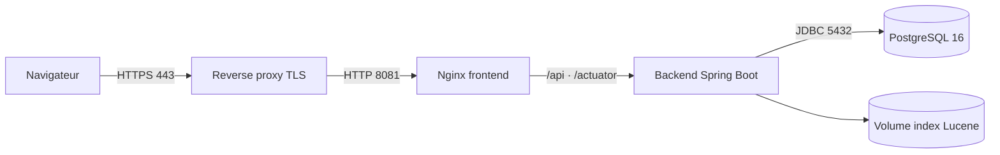

# Déploiement

Ce guide décrit le déploiement de **FastSearch Persons** avec Docker Compose,
puis les éléments à vérifier avant une mise en production.

> [!WARNING]
> La configuration fournie est un **point de départ mono-nœud**. Elle n'est pas
> endurcie pour une exposition directe à Internet. Une revue de sécurité, TLS,
> une gestion de secrets et une politique de sauvegarde sont indispensables.

## 1. Architecture de déploiement



| Service | Port hôte | Rôle |
|---|---|---|
| `frontend` | `8081` | Build statique React servi par Nginx, proxy same-origin vers le backend |
| `backend` | `8080` | API REST, recherche Lucene, audit, évaluation |
| `postgres` | interne | Base de données PostgreSQL 16 |

En production, seul le reverse proxy TLS doit être exposé publiquement. Les
ports `8080` et `8081` peuvent rester liés à `127.0.0.1` ou à un réseau interne.

## 2. Docker Compose

Depuis la racine du monorepo :

```bash
docker compose up --build
```

Services démarrés :

- **PostgreSQL 16** avec le volume `pgdata` ;
- **backend** Spring Boot avec le profil `postgres`, l'index dans le volume
  `indexdata` et les données de démonstration activées par défaut ;
- **frontend** Nginx avec `BACKEND_UPSTREAM=http://backend:8080`.

Accès :

- interface : <http://localhost:8081>
- API : <http://localhost:8080/api/v1>
- santé backend : <http://localhost:8080/actuator/health>
- santé frontend : <http://localhost:8081/healthz>

### Variables d'environnement

Copier le modèle racine et adapter les valeurs :

```bash
cp .env.example .env
```

| Variable | Défaut | Rôle |
|---|---|---|
| `FASTSEARCH_DB_PASSWORD` | `fastsearch` | Mot de passe PostgreSQL |
| `FASTSEARCH_DEMO_ENABLED` | `true` | Données synthétiques au démarrage |
| `FASTSEARCH_BIND_ADDRESS` | `127.0.0.1` | Interface hôte exposée par Docker |
| `FASTSEARCH_BACKEND_PORT` | `8080` | Port hôte du backend |
| `FASTSEARCH_HTTP_PORT` | `8081` | Port hôte du frontend |
| `JAVA_OPTS` | `-XX:MaxRAMPercentage=75` | Options de la JVM backend |

Les ports sont liés à `127.0.0.1` par défaut. Pour exposer l'interface sur le
réseau local, définir `FASTSEARCH_BIND_ADDRESS=0.0.0.0` en conscience des
risques. En production, seul le reverse proxy TLS doit être public.

Exemple avec des valeurs explicites :

```bash
FASTSEARCH_DB_PASSWORD='change-me' \
FASTSEARCH_DEMO_ENABLED=false \
FASTSEARCH_HTTP_PORT=8081 \
docker compose up --build -d
```

Sous PowerShell :

```powershell
$env:FASTSEARCH_DB_PASSWORD = 'change-me'
$env:FASTSEARCH_DEMO_ENABLED = 'false'
docker compose up --build -d
```

### Arrêt et volumes

```bash
# Arrêt sans perte de volumes
docker compose down

# Arrêt avec suppression des volumes (perte des données)
docker compose down -v
```

### Logs et santé

```bash
docker compose ps
docker compose logs -f backend
docker compose logs -f frontend
docker compose logs -f postgres
```

Les trois services disposent d'un healthcheck. Le backend expose
`/actuator/health`, le frontend `/healthz`, PostgreSQL `pg_isready`.

## 3. Déploiement sans Docker

### Backend

```bash
cd backend
mvn clean package
java -jar target/fastsearch-persons.jar
```

Avec PostgreSQL :

```bash
export SPRING_PROFILES_ACTIVE=postgres
export FASTSEARCH_DB_URL=jdbc:postgresql://localhost:5432/fastsearch
export FASTSEARCH_DB_USER=fastsearch
export FASTSEARCH_DB_PASSWORD=change-me
export FASTSEARCH_INDEX_PATH=/var/lib/fastsearch/index
java -jar target/fastsearch-persons.jar
```

### Frontend

```bash
cd frontend
npm ci
npm run build
```

Servir `dist/` avec Nginx, en reprenant `frontend/nginx.conf` et en définissant
`BACKEND_UPSTREAM` vers le backend.

## 4. TLS et reverse proxy

Exemple Nginx minimal devant le frontend :

```nginx
server {
    listen 443 ssl http2;
    server_name fastsearch.example.com;

    ssl_certificate     /etc/letsencrypt/live/fastsearch.example.com/fullchain.pem;
    ssl_certificate_key /etc/letsencrypt/live/fastsearch.example.com/privkey.pem;

    add_header Strict-Transport-Security "max-age=31536000; includeSubDomains" always;

    location / {
        proxy_pass http://127.0.0.1:8081;
        proxy_http_version 1.1;
        proxy_set_header Host $host;
        proxy_set_header X-Real-IP $remote_addr;
        proxy_set_header X-Forwarded-For $proxy_add_x_forwarded_for;
        proxy_set_header X-Forwarded-Proto $scheme;
    }
}

server {
    listen 80;
    server_name fastsearch.example.com;
    return 301 https://$host$request_uri;
}
```

Le frontend Nginx ajoute déjà :

- `Content-Security-Policy` ;
- `X-Content-Type-Options: nosniff` ;
- `X-Frame-Options: DENY` ;
- `Referrer-Policy: strict-origin-when-cross-origin` ;
- `Permissions-Policy` ;
- compression gzip ;
- fallback SPA.

## 5. Sauvegardes

### PostgreSQL

```bash
docker compose exec -T postgres \
  pg_dump -U fastsearch -d fastsearch -Fc > fastsearch-$(date +%Y%m%d).dump
```

Restauration :

```bash
docker compose exec -T postgres \
  pg_restore -U fastsearch -d fastsearch --clean --if-exists < fastsearch-20261115.dump
```

### Index Lucene

L'index est reconstructible depuis la base source. En cas de perte :

```bash
curl -u admin:mot-de-passe -X POST \
  http://localhost:8080/api/v1/admin/index/reindex
```

Il est néanmoins recommandé de sauvegarder le volume `indexdata` pour éviter une
réindexation complète.

### Audit

Le journal d'audit est stocké dans PostgreSQL. Il doit être inclus dans la
sauvegarde et soumis à la politique de conservation définie par l'organisation.

## 6. Checklist de production

### Sécurité

- [ ] HTTPS/TLS terminé par un reverse proxy de confiance.
- [ ] Comptes de démonstration supprimés ou remplacés.
- [ ] `FASTSEARCH_DEMO_ENABLED=false`.
- [ ] Mots de passe et secrets fournis par un gestionnaire de secrets.
- [ ] Origines CORS restreintes au domaine réel.
- [ ] Limitation de débit ajoutée au niveau du reverse proxy.
- [ ] En-têtes de sécurité vérifiés.
- [ ] Revue de sécurité effectuée.
- [ ] Politique de conservation et de purge de l'audit définie.
- [ ] Analyse juridique réalisée (base légale, minimisation, droits des
      personnes).

### Données et exploitation

- [ ] PostgreSQL utilisé à la place de H2.
- [ ] Sauvegardes testées et restaurées sur un environnement de recette.
- [ ] Volume `indexdata` persistant et surveillé.
- [ ] Migrations versionnées (Flyway/Liquibase) à la place de
      `ddl-auto=update`.
- [ ] Synchronisations sérialisées (pas de verrou distribué intégré).
- [ ] Supervision des healthchecks, logs et métriques.
- [ ] Ressources CPU/RAM dimensionnées et limites de conteneur définies.
- [ ] Test de charge réalisé sur un corpus représentatif.
- [ ] Plan de reprise après sinistre documenté.

### Qualité

- [ ] `mvn verify` passe.
- [ ] `npm run typecheck`, `npm run lint`, `npm test` et `npm run build`
      passent.
- [ ] `node scripts/check-markdown-links.mjs` passe.
- [ ] Parcours FR/AR/RTL vérifié.
- [ ] Pagination vérifiée sur plusieurs tailles de page.
- [ ] Aucune donnée personnelle réelle dans le dépôt ou les captures.

## 7. CI/CD

Le workflow racine `.github/workflows/ci.yml` exécute :

1. **backend** : `mvn -B verify` sur Java 17, puis publication du JAR ;
2. **frontend** : `npm ci`, audit de production, typecheck, lint, tests, build,
   puis publication de `dist/` ;
3. **docs** : vérification des liens Markdown ;
4. **compose** : validation de `docker-compose.yml` avec `docker compose config`.

Les quatre jobs sont lancés à chaque push sur `main` et à chaque pull request.
Il n'y a pas encore de filtres par chemins : le workflow reste simple et
prévisible, quitte à exécuter un job inutile lorsqu'une seule partie du
monorepo change.

### Publier une version

```bash
git tag -a v0.1.0 -m 'FastSearch Persons v0.1.0'
git push origin main --tags
```

Le tag déclenche la CI. Les artefacts sont disponibles dans l'onglet Actions du
dépôt.

## 8. Observabilité

- Actuator expose `health`, `info` et `metrics`.
- Les détails de santé sont masqués (`show-details: never`).
- Les endpoints autres que `health` et `info` exigent `ADMIN`.
- Les logs backend sont structurés par niveau et par package.
- Pour une production, ajouter une stack de métriques/traces (Prometheus,
  Grafana, OpenTelemetry) selon l'environnement.

## 9. Dimensionnement et limites

- L'index Lucene est **local au nœud** : pas de réplication ni de haute
  disponibilité intégrée.
- Le backend reranke au maximum `candidate-limit` candidats (500 par défaut).
- Le mode `FULL` vide l'index avant de le remplir : les lecteurs peuvent voir un
  index partiel pendant la reconstruction.
- Deux synchronisations simultanées peuvent se chevaucher : les sérialiser.
- Aucun benchmark de très gros volume n'est fourni.

Voir [Limites connues](limitations.md).

## 10. Dépannage

| Symptôme | Piste |
|---|---|
| `502` sur `/api` | Backend non démarré ou `BACKEND_UPSTREAM` incorrect |
| `401` | Identifiants absents ou invalides |
| `403` | Rôle ou groupe insuffisant |
| Page vide | Vérifier `page`, `size` et le corpus ; le serveur ramène les pages hors limites |
| Frontend inaccessible | Vérifier le port hôte et le healthcheck `/healthz` |
| Index vide après redémarrage | Vérifier le volume `indexdata` et relancer une réindexation |
| Connexion PostgreSQL refusée | Vérifier le healthcheck, le mot de passe et le réseau Compose |

## 11. Documentation associée

- [Architecture](architecture.md)
- [Guide backend](backend.md)
- [Référence API](api.md)
- [Guide frontend](frontend.md)
- [Limites connues](limitations.md)
- [Sécurité](../SECURITY.md)
