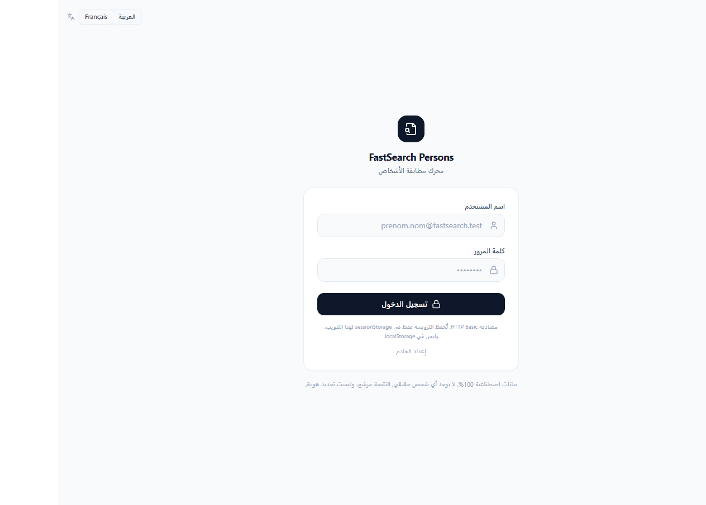
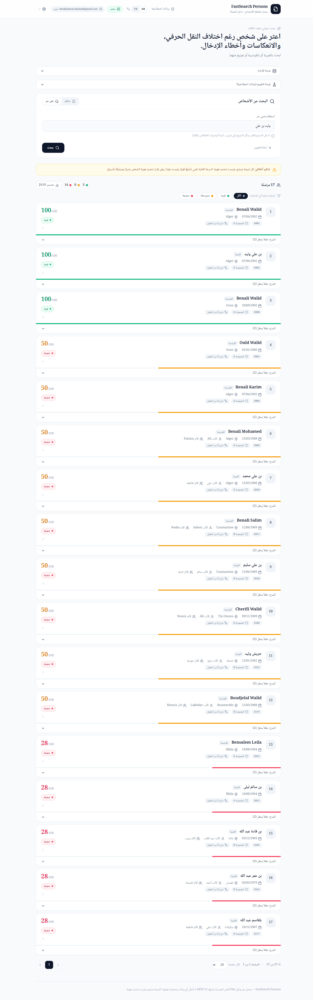
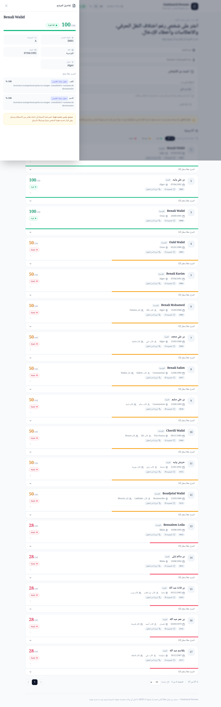
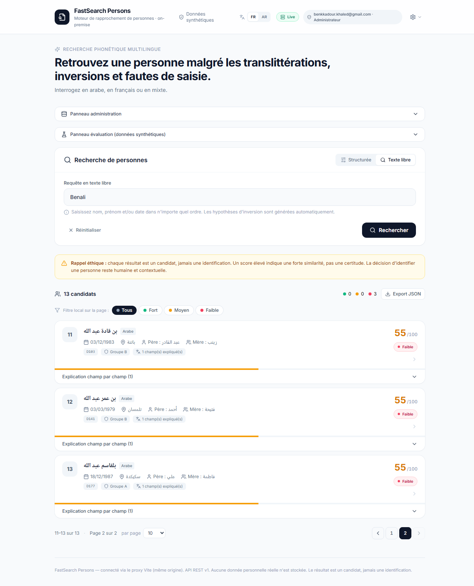
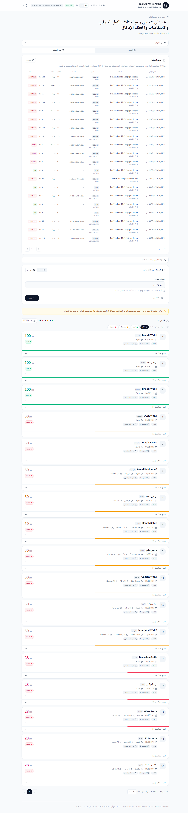

# Guide frontend

L'interface web de **FastSearch Persons** est une SPA React 18 / TypeScript /
Vite / Tailwind CSS. Elle est bilingue **français / arabe**, avec bascule RTL
automatique, et consomme uniquement l'API réelle : **aucun mode démo, aucun
mock**.

> Toutes les données affichées par le projet de démonstration sont
> **synthétiques**. Aucune personne réelle n'est représentée.

## 1. Fonctionnalités

- Recherche structurée (nom, prénom, date, lieu) et recherche en texte libre.
- Interface bilingue **français / arabe**, avec bascule RTL automatique.
- Persistance de la langue choisie et prise en charge de `Noto Naskh Arabic`.
- Cartes de résultats avec score, confiance et explication par champ.
- Pagination serveur avec navigation numérotée et choix de la taille de page.
- Filtre local par niveau de confiance sur la page courante.
- Export JSON des résultats affichés.
- Fiche détaillée d'un candidat.
- Administration de l'index : statistiques, réindexation et synchronisation.
- Journal d'audit et panneau d'évaluation synthétique.
- Authentification HTTP Basic et gestion des rôles côté backend.
- Client API réel : aucun mode démo ou donnée simulée côté frontend.

## 2. Prérequis

- Node.js **20.19+** ou **22.12+** ;
- npm ;
- backend FastSearch Persons démarré sur `http://localhost:8080`.

## 3. Démarrage

```bash
cd frontend
npm ci
npm run dev
```

L'application est disponible sur `http://localhost:5173`. Si ce port est déjà
utilisé :

```bash
npm run dev -- --port 5174
```

> Vite se lie à `localhost` / `::1`. Utiliser `http://localhost:5174/` plutôt
> que `http://127.0.0.1:5174/` lorsque le serveur écoute uniquement sur IPv6.

Vite redirige `/api` et `/actuator` vers le backend. Pour cibler un autre
serveur :

```bash
FASTSEARCH_BACKEND_URL=http://localhost:18080 npm run dev
```

Sous PowerShell :

```powershell
$env:FASTSEARCH_BACKEND_URL = "http://localhost:18080"
npm run dev
```

## 4. Scripts

| Commande | Rôle |
|---|---|
| `npm run dev` | Serveur de développement Vite |
| `npm run build` | Build de production dans `dist/` |
| `npm run preview` | Prévisualisation du build |
| `npm run typecheck` | Vérification TypeScript |
| `npm run lint` | Analyse ESLint |
| `npm test` | Tests unitaires Vitest |
| `npm run test:watch` | Tests en mode watch |

## 5. Configuration

Le backend est configurable depuis l'écran de connexion et le menu des
paramètres. La valeur vide utilise le proxy Vite de même origine.

| Élément | Stockage | Clé |
|---|---|---|
| URL du backend | `localStorage` | `fastsearch_config` |
| Langue | `localStorage` | `fastsearch_language` |
| Session authentifiée | `sessionStorage` | `fastsearch_session` |

Le changement d'URL de backend efface la session pour ne jamais réutiliser des
identifiants Basic vers un autre serveur.

### Variables d'environnement

Copier `.env.example` vers `.env` :

```bash
FASTSEARCH_BACKEND_URL=http://localhost:8080
```

## 6. Internationalisation et RTL

- Dictionnaires FR et AR dans `src/lib/i18n.ts`.
- Toute nouvelle chaîne visible doit être ajoutée aux deux dictionnaires.
- La langue est appliquée à `document.documentElement.lang` et `dir` (`ltr` ou
  `rtl`).
- Les utilitaires Tailwind logiques (`ms`, `me`, `ps`, `pe`, `start`, `end`)
  sont utilisés pour rester compatible RTL.
- Les icônes directionnelles utilisent `rtl:rotate-180`.
- La police `Noto Naskh Arabic` est chargée pour l'arabe.

## 7. Pagination

- Le backend renvoie une page 0-based ; l'interface l'affiche en 1-based.
- Tailles proposées : **10, 20, 50, 100**.
- Navigation numérotée avec ellipse, boutons précédent/suivant et libellé
  « Page X sur Y ».
- Le rang global est conservé entre les pages (`11`, `12`, …).
- La barre reste visible dès qu'il y a des résultats, même sur une seule page.
- Le filtre de confiance est réinitialisé à chaque nouvelle recherche.
- Une page hors limites est ramenée par le serveur à la dernière page
  disponible.

Le composant `Pagination` s'appuie sur `src/lib/pagination.ts`
(`buildPageEntries`) pour calculer la fenêtre de pages. Les tests unitaires
couvrent les bornes, les ellipses et l'absence de doublons.

## 8. Composants

| Composant | Fonction |
|---|---|
| `LoginScreen` | Connexion HTTP Basic, validation des identifiants |
| `SearchForm` | Recherche structurée ou texte libre |
| `ResultCard` | Score, confiance, langue, groupe, dates, parents, explications |
| `PersonDrawer` | Détail latéral complet du candidat |
| `Pagination` | Navigation et taille de page |
| `AdminPanel` | Statistiques, réindexation, synchronisation |
| `AuditLogPanel` | Journal paginé, empreinte, durée, état |
| `EvalPanel` | Métriques, catégories, baselines, suggestions |
| `SettingsBar` | URL backend, rôle, déconnexion |
| `CandidateBanner` | Rappel « candidat, pas identification » |
| `EmptyState` | États vides et absence de résultat |
| `LoadingError` | États de chargement et d'erreur |

## 9. Authentification et session

- HTTP Basic envoyé par le client API.
- Identifiants conservés dans `sessionStorage` pour l'onglet courant.
- Aucun cookie de session serveur.
- Déconnexion = suppression de la session locale.
- Les écrans d'administration et d'évaluation sont affichés selon les rôles
  renvoyés par `/api/v1/auth/me`, mais la décision finale reste côté serveur.

## 10. Accessibilité et ergonomie

- Noms arabes affichés en RTL automatique.
- Scores sur 100 avec barre de progression.
- Badges de confiance colorés (`FORT`, `MOYEN`, `FAIBLE`).
- Avertissements visibles si le résultat est peu fiable.
- Navigation clavier sur les cartes de résultat.
- Drawer accessible (`role="dialog"`, `aria-modal`).
- Libellés ARIA sur les boutons de pagination.
- Interface responsive Tailwind.
- Aucune donnée personnelle réelle affichée.

## 11. Qualité et CI

```bash
npm run typecheck
npm run lint
npm test
npm run build
```

- Tests unitaires Vitest sur l'i18n, l'affichage, les niveaux de confiance et la
  pagination.
- Vérifications `typecheck`, `lint`, `test` et `build` dans GitHub Actions.
- Audit des dépendances de production : `npm audit --omit=dev`.
- Aucun mock ni mode démo dans le client API.

**État vérifié pour la version 0.1.0 : 25 tests, 0 échec.**

## 12. Docker et Nginx

Le frontend peut être servi par Nginx, avec proxy same-origin vers le backend :

```bash
cd frontend
docker build -t fastsearch-persons-frontend .
docker run --rm -p 8081:80 \
  -e BACKEND_UPSTREAM=http://host.docker.internal:8080 \
  fastsearch-persons-frontend
```

L'image finale contient uniquement le build statique et Nginx. Elle ajoute les
en-têtes de sécurité, la compression et le fallback SPA. Sous Linux, ajouter
`--add-host=host.docker.internal:host-gateway` si nécessaire.

Depuis la racine du monorepo, `docker compose up --build` démarre PostgreSQL, le
backend et le frontend. Voir [Déploiement](deployment.md).

## 13. Structure

```text
frontend/
├── public/                 favicon et ressources statiques
├── src/
│   ├── components/         écrans et composants de l'interface
│   ├── lib/                client API, authentification, i18n, affichage
│   ├── App.tsx             application principale
│   ├── main.tsx            point d'entrée React
│   └── types.ts            types partagés
├── Dockerfile
├── nginx.conf
├── package.json
└── vite.config.ts
```

## 14. Captures

| Écran | Aperçu |
|---|---|
| Connexion (arabe) |  |
| Recherche (arabe, RTL) |  |
| Résultats (arabe) |  |
| Fiche candidat (arabe) |  |
| Pagination (français) |  |
| Journal d'audit (arabe) |  |

## 15. Documentation associée

- [English version](frontend-en.md)
- [Architecture](architecture.md)
- [Référence API](api.md)
- [Déploiement](deployment.md)
- [Contribution](../CONTRIBUTING.md)
- [Sécurité](../SECURITY.md)
